# Akkerman Landowners from Montenegro

## Akkerman Landowners from Montenegro, Part 1.

*A year ago in Montenegro I was strolling along the waterfront of the small seaside town of Perast. All around were the azure waves of the Adriatic, crowds of tourists and old palaces, each more beautiful than the last.*

*At the time I did not yet know that I was standing at the origins of a family that bound its fate to distant Akkerman…*

*[Image omitted]* <!-- Image description: Colour photograph of the Perast waterfront on a sunny day, with an old stone palazzo and a parked van at left, a stepped quay, small boats on the bay, and a church bell tower against mountains beyond. -->

The old seaside town of **Perast** reached its height in the **XVIII** century, when it belonged to the Venetian Republic. At that time it had four shipyards, and its fleet numbered up to a hundred ships.

It was here, on the recommendation of the Venetian Senate and at the request of Peter the Great, that the navigator and shipbuilder Marko Martinovich taught Russian noblemen seamanship.

*[Image omitted]* <!-- Image description: Tinted photochrom view along the shore of Perast, with a weathered stone palazzo in the foreground and the town and its tall bell tower on the bay beneath mountains. -->  
*A **1900** postcard*

Most of the native inhabitants of Perast counted themselves among the twelve noble clans of the town.

**The Mazaroviches** were one of the most influential families of Perast. They are mentioned as early as 1334; the family appeared in Perast in the XV c. Among the family's distinguished members were judges, mayors of the town, skilled navigators, writers of the Baroque era and even one painter – Antuan Mazarovich, who was educated in Venice. He painted portraits of members of the Habsburg royal family.

*[Image omitted]* <!-- Image description: Coloured coat of arms: a shield with a three-masted ship on blue water below three green plants and a red star, topped by a helmet with a gold lion crest and green and blue mantling. -->  
*Coat of arms of the Mazaroviches from the General Armorial of the Noble Families of the Russian Empire*

On the Perast waterfront in the mid-XVIII c. the family **palazzo** was built in the classic Baroque style with a central belvedere.

The Mazaroviches chose a site for the building next to their old, smaller house, which still stands beside the palace today. On the ground floor was the entrance, flanked by 4 oval Baroque windows. The second and third floors were decorated with balconies. Behind the palace was an annex that was used as a kitchen. The palace has kept its original room layout and the central drawing room, which retains features of the original interior – remains of a pattern on the walls made of mortar.

Today the building is in ruins. Most interesting of all, the palace was given the status of a ruin as early as **1882**, and ever since its dark walls have towered among the snow-white mansions on the waterfront.

*[Image omitted]* <!-- Image description: Elevated colour photograph of the Perast waterfront: a roofless, ruined stone building among red-roofed houses, palm trees and a small church on a wooded slope, with the credit '© Artemy Lebedev' along the right edge. -->

One of the members of the family, **Giovanni Mazarovich**, served as an admiral in the Venetian fleet.

With the funds of the influential family the Church of St. Anthony was built in Perast, together with a fortress and a monastery, in **1679**. Among other things the monks practised medicine, and the monastery had a pharmacy

The admiral's eldest son, **Simeon Mazarovich**, also became a Doctor of Medicine.

In **1807** he enters Russian service. Until **1809** he serves as a physician at the Russian naval hospital in Livorno.

In **1809-11** Mazarovich was sent as a physician to occupied Moldavia, “*to the Divan in Jassy, to Senator Milashevich*”, at the same time carrying out diplomatic assignments. On 29 March **1810** he was granted the rank of Collegiate Assessor.

He then served at the General Headquarters of the commander of the Danube Army, General-in-Chief Golenishchev-Kutuzov, and of Admiral Chichagov, who replaced him; in **1811** he went on campaigns during the war with the Turks, and a year later he went with the Danube Army as far as the place where Napoleon's army crossed the Berezina.

The deft and courteous Dalmatian was noticed, and in **1812** he began carrying out diplomatic assignments at the court of the Hospodar of Moldavia.

In **1817** Semyon Mazarovich accompanied General Ermolov's mission to Persia as its physician, and there he made such an impression that by Imperial command he was left at the Shah's court as Russian envoy.

And his secretary (in Farsi, “*vazir-mukhtar*”) was A.S. **Griboedov**, who after the Russo-Iranian War replaced him as head of the Russian diplomatic mission in Tehran.

*[Image omitted]* <!-- Image description: Engraving of a carpeted, tiled hall in which a bearded Persian man in a tall black hat shakes hands with a Russian officer in dress uniform while a line of uniformed officers looks on. -->  
*Reception of the embassy by the Persian Shah*

In one of his letters to friends Griboedov wrote:

“*What a pity, though, that you are not here now. Mazarovich has built a most magnificent Palais de Russie. My little house, if only it did not shake so often from earthquakes, would be a sight to behold in the East. And what women you would find at my place! Not just one, but many, each lovelier than the last. Who would have foreseen this two months ago! The ways of love are inscrutable…*”

At that time Semyon's younger brothers – **Osip** and **Spiridon** – lived with him in Tabriz.

Mazarovich's brothers showed their Venetian upbringing: they took to going round the bazaars, buying up heaps of goods to resell in Russia. The envoy himself avoided such conduct, unworthy of a Russian chargé d'affaires, but he did not rein in his brothers either, hoping for their future profits. Osip regularly went off to trade in Russia.

The brothers were also fond of games of chance at cards, in which Griboedov too took part, and they were not above taking bribes.

In **1826** the mission returned to Russia, and Mazarovich was attached to the commander of the Separate Caucasus Corps, and then to the Asiatic Department of the Ministry of Foreign Affairs.

Semyon Mazarovich's wife was **Anastasia Ivanovna Ribopier**, the daughter of a general who was killed in the storming of Izmail and of a maid of honour of Catherine II.

*[Image omitted]* *[Image omitted]* <!-- Image description: Two engraved portraits side by side: a man in a plumed bicorne, lace jabot and buttoned coat, and a young woman with powdered, upswept hair, a black ribbon at her throat and bows down her bodice. -->  
*Semyon Mazarovich's father-in-law and mother-in-law*

… In the years when the cunning “Dalmatian” was making his diplomatic career, a “*demarcation*” of the land was carried out in southern Bessarabia.

After the Tatars left the Budjak, the ruins of Tatar auls [villages] remained in the coastal steppes. New settlements often arose in these places, keeping the Tatar place names in altered form.

Take a look at the map from the Russian Atlas of **1792**:

**Sheba** is today's Shabo, **Sukembeta** is Akkembet, today's Belenkoye, **Kuchukterza** turned into Malaya Katarga (kuchuk is “small” in Tatar), now part of the village of Belenkoye. **Budak** (“knot” in Tatar) is Budaki, today's Primorskoye, Voloban is Balabanovka, Bazerak is Bazaryanka. **Kogdolu** became the urochishche [named tract of land] of Kadieshty.

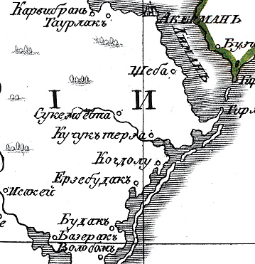 <!-- Image description: Hand-coloured engraved map detail of the liman shore south of Акерманъ, with place names including Шеба, Сукембета, Кучуктерза, Когдолу, Будакъ, Базеракъ and Волобанъ. -->

All the crown land of Akkerman uezd [district], on the basis of an Imperial command of **1812**, was divided into plots of 3000 desyatinas (a desyatina is roughly a hectare).

Part of the land in the Budjak was set aside for the settlement of Bulgarian and German colonies, and part was granted by the Emperor to persons “who had rendered services to the fatherland”.

Thus, for example, the commandant of the Akkerman fortress, Colonel Sergei **Arsenyev**, received land in the **Shabolat** tract.

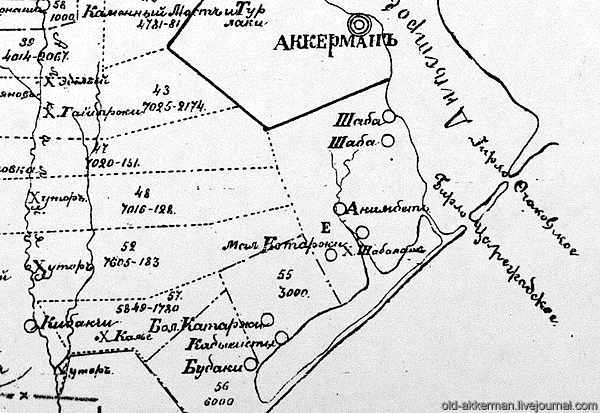 <!-- Image description: Black-and-white survey map of numbered land plots between Аккерманъ and Будаки, showing plot 55 (3000) beside Бол. Катаржи and Кадыешты and plot Е beside Х. Шаболатъ, with an 'old-akkerman.livejournal.com' watermark. -->

And the neighbouring plot No. 55, 3000 desyatinas in size, including the **Kadieshty** and Katorga tracts, was “Most Graciously granted” on 18 June 1823 to the diplomat Semyon Ivanovich Mazarovich.

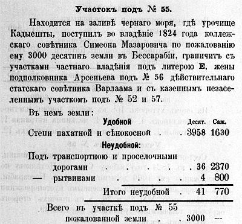 <!-- Image description: Printed text in pre-reform Russian headed 'Участокъ подъ № 55.', describing the 3000 desyatinas at урочище Кадыешты held from 1824 by Симеонъ Мазаровичъ, with a table of arable and unusable land. -->

In **1828** Semyon Mazarovich was, by Imperial command, released on indefinite leave with retention of his salary, which was ordered to be paid from the State Treasury. He will remain on leave until at least **1836**.

On his Bessarabian estate on the shore of the Shabolat liman [coastal lagoon] he sets up a small khutor [farmstead]. Semyon himself lives with his family in Petersburg and on his wife's estate in Tula Governorate, while his middle brother, Osip, settles here.

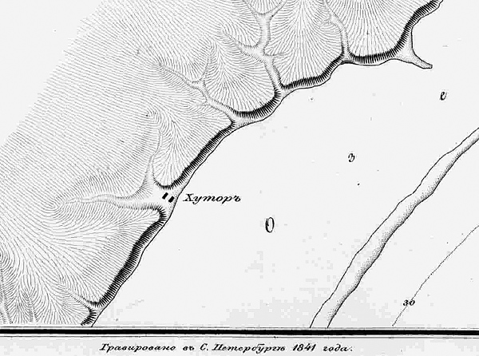 <!-- Image description: Engraved map of a hachured stretch of shoreline with a small settlement marked 'Хуторъ' at the water's edge and the imprint 'Гравировано въ С. Петербургѣ 1841 года' along the bottom. -->  
*Fragment of an **1835** map of the Black Sea coast.*

Almost no one lived on the vast territory. The plot at that time listed: khutors 5; in them wattle houses 3, dugouts 2, sheds 3, tavern 1, stone wells 3 and earthen wells 3.

To work their estate, the Mazaroviches buy *serf folk* in Russia (in Bessarabia itself there was never serfdom).

In **1835**, during the regular census – the *revizskaya skazka* [revision list], as it was called then – there were recorded “*the household serfs attached to the house of the landowner Captain Osip Ivanovich Mazarovich on the Kadieshty dacha [landholding]*”.

On this “dacha” there lived: Samson **Grachev**, 57 years old, with his wife Vasilisa and sons Ivan and Ulyan, and Samson's brother Zakhary **Grachov**, 55 years old, with his sons Trofim, Egor and Osip.

It was evidently a small farm, and not many folk were needed…

*[Image omitted]* <!-- Image description: Handwritten passage in pre-reform Russian beginning 'Доставшіеся по купчей отъ Гвардіи Капитанши Прасковьи Ивановой дочери Раевской…'. -->

All of them “came by deed of purchase from the Guards Captain's wife Praskovya, Ivan's daughter, Raevskaya, – executed in the Tula Chamber of the Civil Court in the year 1832, January the 8th day – from her estate in Tula Governorate, Bogoroditsk uezd, the village of Kuznetsovo of the same governorate, to the landowner State Councillor Semyon Ivanovich Mazarovich, and these were then handed over to his brother Osip Mazarovich on the Kadieshty dacha”.

Curiously, Praskovya **Raevskaya**, née **Arsenyeva**, was a second cousin once removed of the commandant of the Akkerman fortress, Sergei Arsenyev.

“*To this revision list Captain Osip, son of Ivan, Mazarovich has set his hand*”.

*[Image omitted]* <!-- Image description: Handwritten line in pre-reform Russian, set in ruled columns, beginning 'Къ сей Ревизской Сказкѣ Капитанъ…' and ending '…руку приложилъ'. -->

On 20 February **1836** Semyon Mazarovich, a landowner of the Bessarabian and Tula governorates, “being of foreign origin, expressed the wish to take, together with his children, the oath of perpetual allegiance to Russia”, and only a week later received Imperial consent.

On 16 July **1837**, holding the rank of State Councillor, Semyon Ivanovich Mazarovich received a diploma conferring hereditary nobility.

*To be continued…*

## An Akkerman Landowner from Montenegro. Part 2.

*Continued. The beginning is [here](http://old-akkerman.livejournal.com/31201.html).*

In **1831** the border and customs line was moved from the Dniester to the Prut, and the border cordons of the 1st Section of the Border Guard of the 23rd Odessa Brigade were stationed on the Black Sea coast. At the same time our fortress, which now found itself deep in the rear, was abolished as a military installation.

> ***Cordons** – detachments of troops placed at such a distance that they can give help to one another; their duty is: on the seashore, not to allow vessels to put in to shore at places where [this] is not permitted, and on the land border, not to let contraband through.*

The border road ran through the Mazaroviches' lands. Cossacks of the newly formed Danube Cossack Host galloped past their manor, and officers of the border guard began coming to visit.

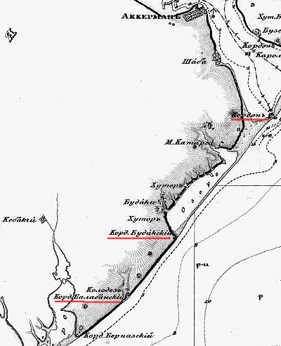 <!-- Image description: Detail of an engraved 19th-century map of the coast south of Akkerman (Шаба, М. Каторга, Будаки), with three cordon posts underlined in red. -->

Life flowed unhurriedly in Nicholaevan Russia.

In **1834** a statute on the **tsarane** (free peasants) was issued in Bessarabia, with the aim of regulating the landowners' treatment of them. And in **1836** landowners were obliged to conclude written agreements with the free peasants living on their lands, specifying precisely their mutual rights and obligations

The lands neighbouring Mazarovich's plot were bought by the **Demidovs** and the **Volkonskys**, and new khutors with their *working people* appeared in the coastal steppe.

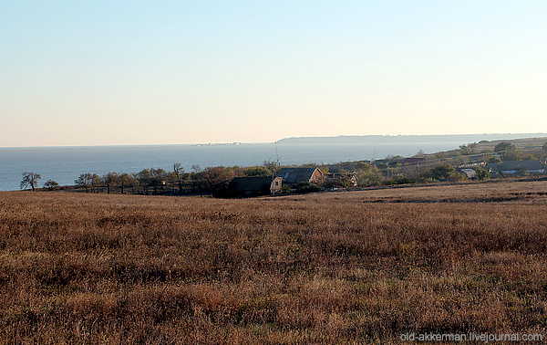 <!-- Image description: Photograph of dry brown steppe in the foreground, with a line of trees and farm buildings and the sea or liman beyond. -->

The Mazaroviches lived on two estates.

The Bessarabian votchina [hereditary estate] brought in income from leasing the land and selling grain and livestock, but the landowners preferred to live on the family estate of Vnukovo near the uezd town of **Krasny** in Smolensk Governorate, closer to the capital.

In **1812** the town of Krasny became famous not only in Russia but throughout the world for the large-scale battles of the Russian army with the troops of the French Emperor Napoleon Bonaparte. Two bloody battles took place on Krasny land.

The name of this town also turned out to be connected with our region. In **1815** German colonization began in Bessarabia. By Imperial command the colonies were named after the battle sites of the recent war with Napoleon.

That is how the German colony of **Krasninskaya** arose near the villages of Tarutino and Paris in Bessarabia. Today it is the village of **Krasnoye** in Tarutino Raion.

*[Image omitted]* <!-- Image description: Reproduction of a painting of a winter battle, with masses of cavalry and infantry fighting across snowy ground under a smoky sky. -->  
*Illustration of Hess's painting “The Battle of Krasny, 5 November 1812”*

Semyon Mazarovich and Anastasia **Ribopier** had two children from their marriage: a daughter, **Elizaveta**, and a son, **Ivan**.

Vanya was born around **1822**, while his father was still serving in Persia. When he grew up, he chose military service, like his grandfather – Ivan Stepanovich Ribopier.

Ivan Mazarovich became an officer in **1844**. He served in the army cavalry. He was an officer for special assignments under the Governor-General of Eastern Siberia, N.N. Muravyov.

In February **1853** Major Mazarovich is appointed commander of the **Yenisei Cossack Regiment** in Krasnoyarsk.

In April the new voiskovoi starshina [a Cossack rank then equivalent to major] Ivan Semyonovich Mazarovich takes over the regiment. From the very first days he tries to bring order to his unit and to root out “*Cossack unruliness*”.

The artist **Surikov**, whose uncles served in this very regiment, later recalled their words: “*A cruel man he was. He flogged Cossacks to death*”.

For Mazarovich, Siberia is a wild backwater. His heart is not in it, but it has to be endured…

*[Image omitted]* <!-- Image description: Colour lithograph of three officers in dark green tunics and tall black fur caps standing on a sandy plain, one with silver epaulettes and an aiguillette. -->

Ivan Semyonovich Mazarovich was no simple man – a nobleman by birth, the son of a diplomat, the chargé d'affaires in Persia, whose secretary was none other than the future writer A.S. Griboedov…

And the lieutenant colonel's wife came from the highest circles, and her sister was married to Rear Admiral **Nevelskoy**.

The young people met in the uezd town of Krasny in Smolensk Governorate, where their family estates were.

The sisters Sasha, Vera and Katya **Elchaninov** had graduated from the Smolny Institute for Noble Maidens and were well educated: they knew world and Russian history, geography, literature, the French and German languages, could play music, were keen on theatre and horseback riding, and read a great deal.

In January **1853** the wedding took place of Ivan Mazarovich and Alexandra Elchaninova, a hereditary noblewoman and niece of the Governor of Irkutsk.

*[Image omitted]* <!-- Image description: Oval portrait photograph of a woman with braided, coiled hair, in a dark dress with a white lace collar. -->  
*Alexandra Ivanovna Mazarovich, née Elchaninova*

In **1852** the former diplomat Semyon Mazarovich dies in Moscow.

The commander of the Krasnoyarsk Cossack regiment travels to Akkerman – inheritance matters had to be settled. After long lawsuits his father's Bessarabian estate went to Ivan Semyonovich.

Colonel Mazarovich's family rents an apartment in Petersburg on Sergievskaya Street (now Tchaikovsky Street), in house number 46, on the same landing as their relatives the Nevelskoys.

In **1860** a son, **Kolya**, is born to the young couple

Every summer the sisters rent a dacha near Tsarskoye Selo and go there with the children.

“*The place here is beautiful, there are many walks, quite rural, so that we forget that Petersburg is 27 versts [a verst is about 1.07 km] away. The dacha is only five versts from Peterhof, and we often visit the fountains and palaces…*”

The reform of **1861** affected the summer holidays of the Mazarovich and Nevelskoy families. The heads of the families went off to their estates to give orders and arrange new terms with the peasants.

In **1856** Ivan Mazarovich becomes a lieutenant colonel, in **1862** a colonel. In **1872** he received the rank of major general and until **1882** was listed in the reserve troops.

Ivan Semyonovich Mazarovich died on 5 June **1896** and was buried at the Vvedenskoye Cemetery in Moscow.

*[Image omitted]* <!-- Image description: Photograph of a dark stone gravestone with a cross, inscribed 'Генералъ-маіоръ Иванъ Семеновичъ Мазаровичъ' and 'скончался 15 іюня 1896 г.', partly hidden by foliage. -->

...After the **Crimean War** great changes took place in Bessarabia and throughout Russia.

Under the terms of the **Peace of Paris**, Izmail uezd and part of Akkerman uezd were transferred to the Principality of Moldavia, and a new state border ran very close to the Mazarovich estate.

In **1868** a peasant reform was carried out in Bessarabia. The peasants received land allotments of various sizes “*from the votchinas on which they had been settled*”.

New settlements arise on the landowners' lands – near the village of Budaki the German colony of **Neifal** is built (now part of the village of Primorskoye), on the land of Princess Volkonskaya the settlements of **Adamovka** and **Pavlovka** are founded, and on the site of the **Kayabey** khutor a village of the same name arises (now the village of Blagodatnoye).

There was once a Tatar settlement here, named after the Tatar khan Kayabey, an ally of the Crimean khan Mehmed IV Giray. In **1659** the combined Cossack and Tatar army under the command of Ivan Vygovsky and Mehmed IV Giray routed the Russian host led by Prince Trubetskoy at the Battle of Konotop.

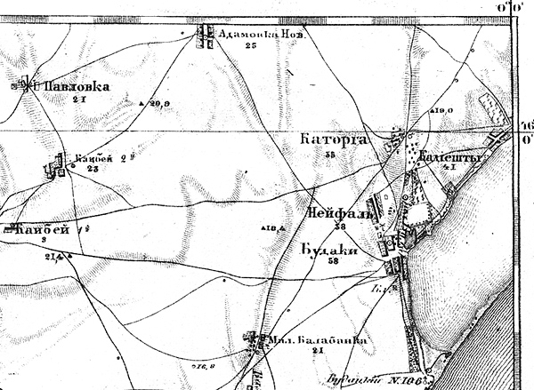 <!-- Image description: Engraved map showing Павловка, Адамовка Нов., Каябей, Каторга, Кадиешты, Нейфаль, Будаки and Мал. Балабанка near the liman shore. -->  
*Fragment of an **1868** map*

In the early **1870**s an administrative reform was carried out in Bessarabia. The Bessarabian Oblast becomes a governorate, the zemstvo [elected local self-government] is introduced, the colonists' privileges are abolished, and Akkerman uezd is divided into volosts [rural districts].

Kadieshty now belongs to the **Shabskaya** volost, and later to the Postalskaya volost.

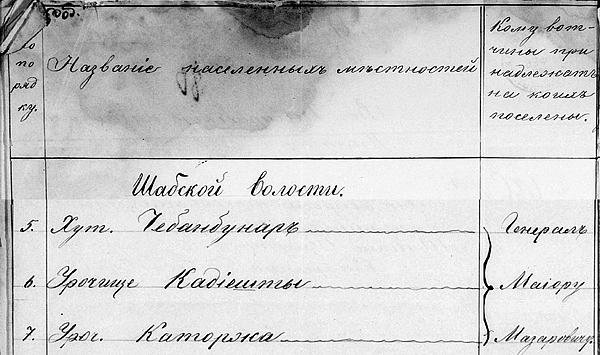 <!-- Image description: Handwritten register page with the columns 'Название населенныхъ мѣстностей' and 'Кому вотчины принадлежатъ на коихъ поселены', listing under 'Шабской волости' 5. Хут. Чебанбунаръ, 6. Урочище Кадіешты and 7. Уроч. Каторжка, bracketed against 'Генералъ Маіору Мазаровичу' ('Names of inhabited places'; 'To whom belong the votchinas on which they are settled'; 'To General-Major Mazarovich'). -->

The settlements grow quickly; meshchane [urban commoners, a legal estate] of Akkerman and free peasants from the former state villages settle in them.

In **1870** Kadieshty has 27 houses, in **1875** already 44 dwellings. According to the statistics, the village is considered “*prosperous*”.

And in the gully next to the Kadieshty “dacha”, where the shepherds drove the livestock to water, the khutor of **Cheban-Bunar** (shepherd's well) arises.

In **1875** this khutor already counts 13 houses. Today it is the village of **Chabanskoye**.

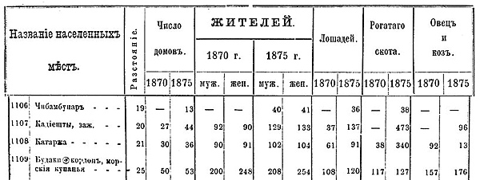 <!-- Image description: Printed statistical table giving houses, inhabitants by sex, horses, cattle and sheep in 1870 and 1875 for four places, including Кадіешты and Будаки. -->

In its report the Shabskaya volost board stated that the khutors of **Chebanbunary**, **Kadieshty** and **Katorga** were settled by meshchane of the town of Akkerman and its posady [suburbs], who use the land “*by agreements with the owners of the votchinas*”.

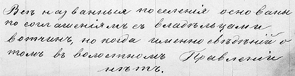 <!-- Image description: Handwritten note in pre-reform Russian: 'Всѣ названныя поселенія основаны по соглашеніямъ съ владѣльцами вотчинъ, но когда именно свѣдѣній о томъ въ волостномъ Правленіи нѣтъ.' ('All the named settlements were founded by agreements with the owners of the votchinas, but as to when exactly, the volost board has no information.') -->

Until the First World War the surrounding area continued to develop.

On the land of Sofia **Benkendorf-Demidova-Kochubey** the German colony of **Sofiental** arose (now Sofievka).

The heirs of Colonel Sergei Arsenyev founded the khutor of **Sergeevka** a little way off from Shabolat – later a mud-cure clinic will be built there and a balneological resort founded.

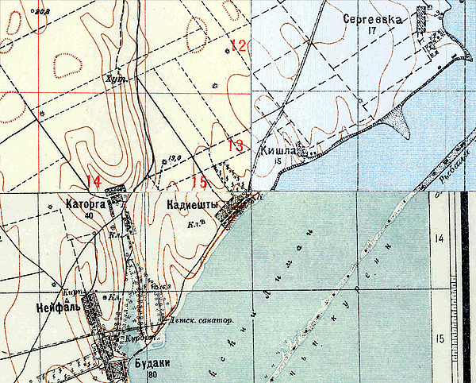 <!-- Image description: Section of a colour topographic map showing Сергеевка, Кишла, Каторга, Кадиешты, Нейфаль and Будаки on the liman shore, with a 'Детск. санатор.' marked and red grid numbers. -->

Not far from the village of Budaki the wealthy Akkerman Armenians the **Eremeevs** bought a large plot of land from the Demidov heirs. The Eremeevs' ekonomiya [estate farm] was not far from the village of Katorga. (Alas, their khutor has not survived to our day).

In **1904** Georgy Eremeev set aside 5 desyatinas of land on the shore of the liman for the establishment of a **children's shelter-sanatorium**.

*[Image omitted]* <!-- Image description: Printed paragraph in pre-reform Russian headed 'Дѣтскій пріютъ.—Санаторія въ селѣ Будакахъ Аккерманскаго уѣзда', about Georgy Eremeev's 1904 gift of 5 desyatinas of land. -->

Soon a small “*sanatorium*” was built on the shore of the Shabolat liman.

Before the First World War children from Moscow rested and received treatment there, and during the war wounded soldiers completed their recovery there.

In Romanian times a small village, **Popazdra**, arose next to the sanatorium.

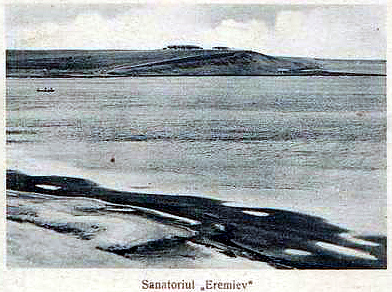 <!-- Image description: Old postcard view across the water to a low headland with buildings, with the printed caption 'Sanatoriul „Eremiev"'. -->

In Soviet times the Children's Dermatological Sanatorium “**Dalny**” operated here. Balneotherapy with the local medicinal mineral water, mud therapy, and climatotherapy and thalassotherapy were successfully used here.

Alas, since the early 2000s the sanatorium has not been operating.

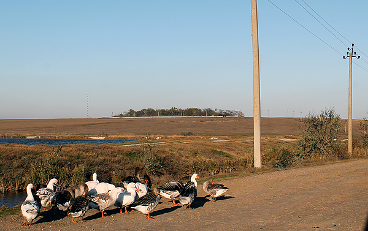 <!-- Image description: Photograph of geese on a dirt road beside utility poles, with reeds, water and a low ridge in the distance. -->

*To be concluded…*
