# Аккерманские помещики из Монтенегро

## Аккерманские помещики из Монтенегро, Часть 1-я.

*Год назад в Черногории я гулял по набережной маленького приморского городка Пераст. Вокруг были лазурные волны Адриатики, толпы туристов и старинные дворцы, один красивее другого.*

*Тогда я еще не знал, что стою у истоков семьи, связавшей свою судьбу с далеким Аккерманом…*

*[Image omitted]* <!-- Image description: Colour photograph of the Perast waterfront on a sunny day, with an old stone palazzo and a parked van at left, a stepped quay, small boats on the bay, and a church bell tower against mountains beyond. -->

Старинный приморский город **Пераст** достиг расцвета в **XVIII** веке, когда он принадлежал Венецианской республике. Тогда в нем насчитывалось четыре корабельных верфи, а его флот достигал сотни кораблей.

Это именно здесь по рекомендации венецианского сената и просьбе Петра Великого мореплаватель и кораблестроитель Марко Мартинович обучал русских дворян морскому делу .

*[Image omitted]* <!-- Image description: Tinted photochrom view along the shore of Perast, with a weathered stone palazzo in the foreground and the town and its tall bell tower on the bay beneath mountains. -->  
*Открытка **1900** года*

Большинство коренных жителей Пераста относили себя к двенадцати знатным родам города.

**Мазаровичи** - это была одна из самых влиятельных семей Пераста. Упоминаются еще в 1334г, в Перасте появилась в XVв. Среди выдающихся представителей рода были судьи, мэры города, умелые мореплаватели, писатели эпохи барокко и даже один живописец - Антуан Мазарович, получивший образование в Венеции. Писал портреты членов королевской семьи Габсбургов.

*[Image omitted]* <!-- Image description: Coloured coat of arms: a shield with a three-masted ship on blue water below three green plants and a red star, topped by a helmet with a gold lion crest and green and blue mantling. -->  
*Герб Мазаровичей из Общего гербовника дворянских родов Российской Империи*

На набережной Пераста в середине XVIIIв был построен семейный **палаццо** в классическом стиле барокко с центральным бельведером.

Мазаровичи выбрали место для постройки рядом со своим старым домом, меньшего размера, который и сейчас находится рядом с дворцом. На первом этаже находился вход, по бокам от него 4 овальных барочных окна. Второй и третий этажи были украшены балконами. Позади дворца располагался пристрой, который использовался как кухня. Дворец сохранил оригинальное расположение комнат и центральную гостиную, в которой присутствуют черты первоначального интерьера - остатки узора на стенах, выполненного из строительного раствора.

Сейчас здание в разрушенном состоянии. Самое интересное, что статус руин дворец получил еще в **1882** году, и с тех пор его темные стены высятся среди белоснежных особняков на набережной.

*[Image omitted]* <!-- Image description: Elevated colour photograph of the Perast waterfront: a roofless, ruined stone building among red-roofed houses, palm trees and a small church on a wooded slope, with the credit '© Artemy Lebedev' along the right edge. -->

Один из представителей семьи, **Джованни Мазарович**, служил адмиралом в венецианском флоте.

На средства влиятельной семьи в Перасте была построена церковь Святого Антония, вместе с крепостью и монастырем в **1679** году. Монахи, среди прочего, занимались медициной, при монастыре была аптека

Старший сын адмирала **Симеон Мазарович** также стал Доктором медицины.

В **1807** году он поступает на русскую службу. До **1809** года он служит лекарем в русском военно-морском госпитале в Ливорно.

В **1809-11** гг. Мазарович был направлен врачом в оккупированую Молдавию «*к Дивану в Яссы к сенатору Милашевичу*», одновременно исполнял и дипломатические поручения. 29 марта **1810** года пожалован чином коллежского асессора.

Затем он служил при Главной квартире командующего Дунайской армией генерал-аншефа Голенищева-Кутузова и сменившего его адмирала Чичагова, в **1811** г. был в походах во время войны с Турками, год спустя прошёл с Дунайской армией до места переправы армии Наполеона через Березину.

Ловкого обходительного далматинца заметили, и в **1812** году он стал исполнять дипломатические поручения при дворе Молдавского господаря.

В **1817** г. Семен Мазарович сопровождал миссию генерала Ермолова в Персию в качестве врача, где произвёл такое впечатление, что по Высочайшему повелению был оставлен при дворе шаха русским посланником.

А секретарем (на фарси - "*вазир-мухтаром*") у него служил А.С.**Грибоедов**, который после русско-иранской войны сменил его на посту главы русской дипломатической миссии в Тегеране.

*[Image omitted]* <!-- Image description: Engraving of a carpeted, tiled hall in which a bearded Persian man in a tall black hat shakes hands with a Russian officer in dress uniform while a line of uniformed officers looks on. -->  
*Прием посольства персидским шахом*

В одном из писем друзьям Грибоедов писал:

«*Как жаль однако, что вас теперь нет здесь. Мазарович отстроил Palais de Russie великолепнейший. Мой домик, кабы не колебался так часто от землетрясений, загляденье на Востоке. И каких бы вы женщин у меня нашли! Именно не одну, а многих, и одна прелестнее другой. Кто бы это предвидел месяца два тому назад! Пути любви неисповедимы…*»

В это время в Тавризе вместе с Семеном жили его младшие братья – **Осип** и **Спиридон**.

В братьях Мазаровича сказалось венецианское воспитание, и они принялись ходить по базарам, скупая груды товаров, чтобы перепродать в России. Сам посланник избегал такого недостойного русского поверенного в делах поведения, но и не одергивал братьев, надеясь на их будущие барыши. Осип регулярно отправлялся торговать в Россию.

Любили братья и азартные карточные игры, в которых участвовал и Грибоедов, не чуждались они и брать взятки.

В **1826** году миссия возвратилась в Россию, и Мазарович был прикомандирован к командующему Отдельным Кавказским корпусом, а затем к Азиатскому департаменту Министерства иностранных дел.

Женой Семена Мазаровича стала **Анастасия Ивановна Рибопьер**, дочь генерала, погибшего при штурме Измаила и фрейлины Екатерины II.

*[Image omitted]* *[Image omitted]* <!-- Image description: Two engraved portraits side by side: a man in a plumed bicorne, lace jabot and buttoned coat, and a young woman with powdered, upswept hair, a black ribbon at her throat and bows down her bodice. -->  
*Тесть и теща Семена Мазаровича*

… В те годы, когда хитрый «далматинец» делал дипломатическую карьеру, в южной Бессарабии было проведено «*размежевание*» земли.

После выхода татар из Буджака в приморских степях остались развалины татарских аулов. В этих местах часто возникали новые поселения, оставлявшие себе в измененном виде татарские топонимы.

Взгляните на карту из Российского атласа **1792** года:

**Шеба** – это современное Шабо, **Сукембета** – это Аккембет, современное Беленькое, **Кучуктерза** – превратилось в Малую Катаргу (кучук – «малый» по-татарски), сейчас входит в состав села Беленькое. **Будак** (узел по-татарски) – это Будаки, современное Приморское, Волобань – Балабановка, Базерак – Базарьянка. **Когдолу** стало урочищем Кадиешты.

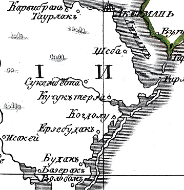 <!-- Image description: Hand-coloured engraved map detail of the liman shore south of Акерманъ, with place names including Шеба, Сукембета, Кучуктерза, Когдолу, Будакъ, Базеракъ and Волобанъ. -->

Вся земля Аккерманского уезда, принадлежащая казне, на основании Высочайшего повеления **1812** года, была разграничена на участки по 3000 десятин (десятина – примерно гектар).

Часть земель в Буджаке была выделена под поселение болгарских и немецких колоний, а часть Высочайше пожалована лицам, «которые оказали услуги отечеству».

Так, например, получил землю в урочище **Шаболат** комендант Аккерманской крепости полковник Сергей **Арсеньев**.

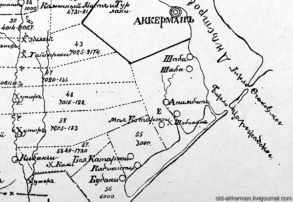 <!-- Image description: Black-and-white survey map of numbered land plots between Аккерманъ and Будаки, showing plot 55 (3000) beside Бол. Катаржи and Кадыешты and plot Е beside Х. Шаболатъ, with an 'old-akkerman.livejournal.com' watermark. -->

А соседний участок № 55, размером в 3000 десятин, включающий урочища **Кадиешты** и Каторга, 18 июня 1823 г был «Всемилостивейше пожалован» дипломату Семену Ивановичу Мазаровичу.

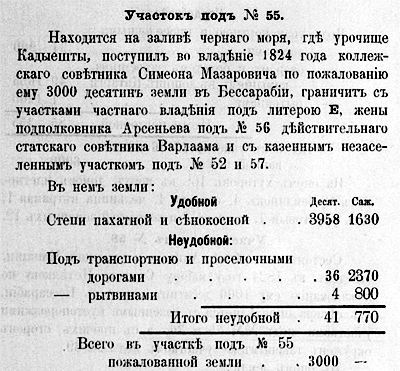 <!-- Image description: Printed text in pre-reform Russian headed 'Участокъ подъ № 55.', describing the 3000 desyatinas at урочище Кадыешты held from 1824 by Симеонъ Мазаровичъ, with a table of arable and unusable land. -->

В **1828** году Семен Мазарович по Высочайшему повелению уволен в бессрочный отпуск с сохранением жалования, которое повелено производить из Государственного Казначейства. В отпуске он будет по крайней мере до **1836** года.

В своем бессарабском имении на берегу Шаболатского лимана он заводит небольшой хутор. Сам Семен с семьей живет в Петербурге и в имении жены в Тульской губернии, а здесь поселяется его средний брат, Осип.

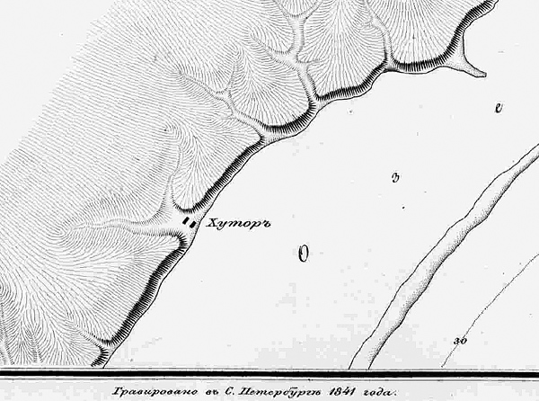 <!-- Image description: Engraved map of a hachured stretch of shoreline with a small settlement marked 'Хуторъ' at the water's edge and the imprint 'Гравировано въ С. Петербургѣ 1841 года' along the bottom. -->  
*Фрагмент карты побережья Черного моря **1835** года.*

На огромной территории почти никто не жил. На участке в то время числилось: хуторов 5; в них домов плетневых 3, землянок 2, сараев 3, корчма 1, колодезей каменных 3 и земляных 3.

Чтобы обслуживать свое имение, Мазаровичи покупают *крепостных людишек* в России (в самой Бессарабии крепостного права никогда не было).

В **1835** году, во время очередной переписи – *ревизской сказки*, как тогда говорили – были переписаны «*дворовые люди, состоящие при доме помещика капитана Осипа Ивановича Мазаровича на даче Кадиешты*».

На этой "даче" жили: Самсон **Грачев**, 57 лет с женой Василисой и сыновьями Иваном и Ульяном, брат Самсона Захарий **Грачов** 55 лет с сыновьями Трофимом, Егором и Осипом.

Небольшое видимо было хозяйство, и людишек требовалось немного…

*[Image omitted]* <!-- Image description: Handwritten passage in pre-reform Russian beginning 'Доставшіеся по купчей отъ Гвардіи Капитанши Прасковьи Ивановой дочери Раевской…'. -->

Все они «достались по купчей от Гвардии Капитанши Прасковьи Ивановой дочери Раевской, - совершенной в Тульской палате Гражданского суда в 1832 год Генваря 8 дня из имения ее Тульской губернии Богородицкого уезда села Кузнецова той же губернии помещику Статскому советнику Семену Ивановичу Мазаровичу, и таковые переданы тогда же брату его Осипу Мазаровичу на дачу Кадиешты».

Любопытно, что Прасковья **Раевская**, урожденная **Арсеньева**, приходилась троюродной племянницей коменанту Аккерманской крепости Сергею Арсеньеву.

«*К сей ревизской сказке капитан Осип Иванович сын Мазарович руку приложил*».

*[Image omitted]* <!-- Image description: Handwritten line in pre-reform Russian, set in ruled columns, beginning 'Къ сей Ревизской Сказкѣ Капитанъ…' and ending '…руку приложилъ'. -->

20 февраля **1836** года Семен Мазарович, помещик Бессарабской и Тульской губерний, «происходя из иностранцев, изъявил желание принять с детьми своими присягу на вечное подданство России» и уже неделю спустя получил Высочайшее согласие.

16 июля **1837** года, находясь в чине статского советника, Семен Иванович Мазарович получил диплом на потомственное дворянское достоинство.

*Продолжение следует…*

## Аккерманский помещик из Монтенегро. Часть 2-я.

*Продолжение. Начало [тут](http://old-akkerman.livejournal.com/31201.html).*

В **1831** году погранично-таможенная линия была перенесена с Днестра на Прут, а на черноморском побережье разместились пограничные кордоны 1-го Отдела пограничной стражи 23-й Одесской бригады. Тогда же наша крепость, оказавшаяся в глубоком тылу, была упразднена, как военный объект.

> ***Кордоны** - отряды войскъ, находящіеся на такомъ разстоянія, что могутъ подавать другь другу помощь; обязанность ихъ: на морскомъ берегу не допускать суда приставать къ берегу въ такихъ мѣстахъ, гдѣ вю не дозволено, а на сухой границѣ не пропускать контрабанды.*

Через земли Мазаровичей пролегла пограничная дорога. Мимо их усадьбы скакали казаки из новообразованного Дунайского казацкого войска, а в гости стали приезжать офицеры пограничной стражи.

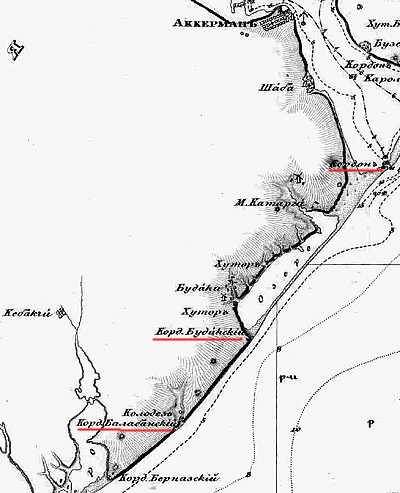 <!-- Image description: Detail of an engraved 19th-century map of the coast south of Akkerman (Шаба, М. Каторга, Будаки), with three cordon posts underlined in red. -->

Неспешно текла жизнь в николаевской России.

В **1834** году в Бессарабии издано положение о **царанах** (свободных поселянах) с целью унормировать отношение к ним помещиков. А в **1836** году вменено землевладельцам в обязанность заключить с живущими на их землях свободными поселянами письменные условия с точным обозначением взаимных прав и обязанностей

Соседние с участком Мазаровича земли выкупили **Демидовы** и **Волконские**, и в приморской степи появились новые хутора с их *работными людьми*.

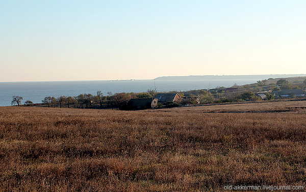 <!-- Image description: Photograph of dry brown steppe in the foreground, with a line of trees and farm buildings and the sea or liman beyond. -->

Мазаровичи жили на два имения.

Бессарабская вотчина давала доходы от аренды земли и продажи зерна и скота, но жить помещики предпочитали в семейном имении Внуково около уездного города **Красный** Смоленской губернии, поближе к столице.

Город Красный в **1812** году стал известен не только в России, но и во всем мире масштабными сражениями русской армии с войсками французского императора Наполеона Бонапарта. На Краснинской земле произошли два кровопролитных сражения.

Название этого города также оказалось связанным с нашими краями. В **1815** году в Бессарабии началась немецкая колонизация. По Высочайшему повелению имена колониям давались по местам сражений недавней войны с Наполеоном.

Так возникла немецкая колония **Краснинская** возле сел Тарутино и Парижа в Бессарабии. В наши дни это село **Красное** Тарутинского района.

*[Image omitted]* <!-- Image description: Reproduction of a painting of a winter battle, with masses of cavalry and infantry fighting across snowy ground under a smoky sky. -->  
*Иллюстрация картины Гесса «Сражение под Красным 5 ноября 1812 года»*

У Семена Мазаровича в браке с Анастасией **Рибопьер** было двое детей: дочь **Елизавета** и сын **Иван**.

Ваня родился около **1822** года, еще когда его отец служил в Персии. Когда подрос, выбрал военную службу, как и его дед – Иван Степанович Рибопьер.

Офицером Иван Мазарович стал в **1844** году. Служил по армейской кавалерии. Состоял порученцем по особым поручениям при генерал-губернаторе Восточной Сибири Н.Н. Муравьеве.

В феврале **1853** года майор Мазарович назначается командиром **Енисейского казачьего полка** в Красноярске.

В апреле новый войсковой старшина Иван Семенович Мазарович принимает полк. С первых дней в своем подразделении он старается навести порядок, искоренить «*казачью вольницу*».

Художник **Суриков**, дядья которого служили в этом самом полку, вспоминал позже их слова: «*Жестокий был человек. Насмерть засекал казаков*”.

Сибирь для Мазаровича — дикая глушь. Душа не лежит, а терпеть надо…

*[Image omitted]* <!-- Image description: Colour lithograph of three officers in dark green tunics and tall black fur caps standing on a sandy plain, one with silver epaulettes and an aiguillette. -->

Непростым человеком был Иван Семенович Мазарович — дворянин по происхождению, сын дипломата, поверенного в делах Персии, секретарем у которого был не кто-нибудь, а будущий писатель А.С. Грибоедов…

И жена у подполковника из высших кругов, а ее сестра — замужем за контр-адмиралом **Невельским**.

Молодые люди познакомились в уездном городе Красном Смоленской губернии, где были их родовые имения.

Сестры Саша, Вера и Катя **Ельчаниновы** окончили Смольный институт благородных девиц и были хорошо образованы: знали всеобщую и российскую историю, географию, литературу, французский и немецкий языки, могли музицировать, увлекались театром, верховой ездой, много читали.

В январе **1853** года состоялась свадьба Ивана Мазаровича и Александры Ельчаниновой, потомственной дворянки и племянницы Иркутского губернатора.

*[Image omitted]* <!-- Image description: Oval portrait photograph of a woman with braided, coiled hair, in a dark dress with a white lace collar. -->  
*Александра Ивановна Мазарович, урожденная Ельчанинова*

В **1852** году в Москве умирает бывший дипломат Семен Мазарович.

Командир казачьего Красноярского полка едет в Аккерман – надо было решать наследственные вопросы. После долгих судебных тяжб бессарабское имение отца досталось Ивану Семеновичу.

Семья полковника Мазаровича снимает квартиру в Петербурге на Сергиевской улице (ныне Чайковского), в доме номер 46, на одной лестничной площадке с родственниками Невельскими.

В **1860** году у молодой пары рождается сын **Коля**

Каждое лето сестры снимают дачу около Царского Села и выезжают туда с детьми.

«*Место здесь прекрасное, прогулок много совершенно деревенских, так что мы забываем, что Петербург в 27 верстах. Дача всего в пяти верстах от Петергофа, и мы часто навещаем фонтаны и дворцы…*»

Реформа **1861** года повлияла на летний отдых семей Мазаровичей и Невельских. Главы семейств отправились в свои имения, для распоряжений и новых условий с крестьянами.

В **1856** году Иван Мазарович становится подполковником, в **1862** году – полковником. В **1872** году он получил звание генерал-майора и до **1882** года числился в запасных войсках.

Скончался Иван Семенович Мазарович 5 июня **1896** года и был похоронен на Введенском кладбище в Москве.

*[Image omitted]* <!-- Image description: Photograph of a dark stone gravestone with a cross, inscribed 'Генералъ-маіоръ Иванъ Семеновичъ Мазаровичъ' and 'скончался 15 іюня 1896 г.', partly hidden by foliage. -->

...После **Крымской войны** в Бессарабии и во всей России прошли большие изменения.

Согласно условиям **Парижского мира** Измаильский уезд и часть Аккерманского были переданы Молдавскому княжеству и совсем рядом с имением Мазаровичей пролегла новая государственная граница.

В **1868** году в Бессарабии была проведена крестьянская реформа. Крестьяне получили различной величины земельные наделы «*из состава вотчин, на которых были водворены*».

На помещичьих землях возникают новые поселения – возле села Будаки строится немецкая колония **Нейфаль** (сейчас входит в состав села Приморское), на земле княгини Волконской основываются селения **Адамовка** и **Павловка**, на месте хутора **Каябей** возникает одноименное село (сейчас село Благодатное).

Когда-то тут было татарское поселение, названное по имени татарского хана Каябея, союзника крымского хана Мехмеда IV Гирея. В **1659** году объединенная казацко-татарская армия под командованием Ивана Выговского и Мехмед IV Гирея разгромила русскую рать под предводительством князя Трубецкого в битве под Конотопом.

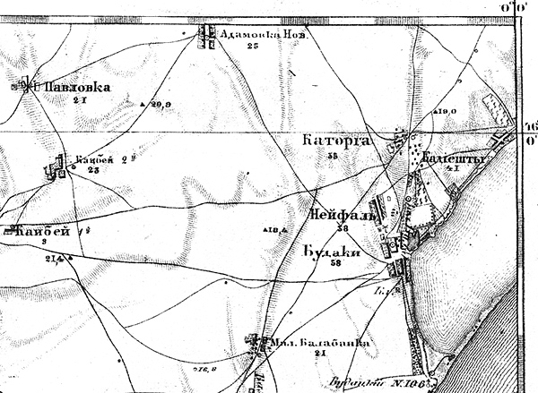 <!-- Image description: Engraved map showing Павловка, Адамовка Нов., Каябей, Каторга, Кадиешты, Нейфаль, Будаки and Мал. Балабанка near the liman shore. -->  
*Фрагмент карты **1868** года*

В начале **1870**-х годов в Бессарабии была проведена административная реформа. Бессарабская область становиться губернией, вводится Земство, отменяются колонистские привилегии, Аккерманский уезд разделен на волости.

Теперь Кадиешты относятся к **Шабской**, а впоследствии к Постальской волости.

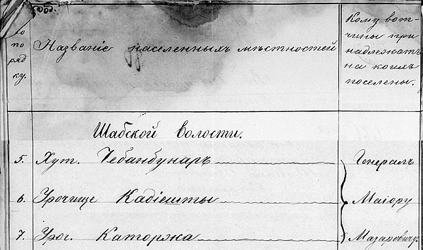 <!-- Image description: Handwritten register page with the columns 'Название населенныхъ мѣстностей' and 'Кому вотчины принадлежатъ на коихъ поселены', listing under 'Шабской волости' 5. Хут. Чебанбунаръ, 6. Урочище Кадіешты and 7. Уроч. Каторжка, bracketed against 'Генералъ Маіору Мазаровичу'. -->

Селения быстро прирастают, в них селятся аккерманские мещане и свободные поселяне из бывших казенных деревень.

В **1870** году в Кадиештах числится 27 домов, в **1875**-м – уже 44 домостроения. Согласно статистики, село считается «*зажиточным*».

А в соседней с «дачей» Кадиешты балкой, куда пастухи гоняли скот на водопой, возникает хутор **Чебан-Бунар** (чебанский колодец).

В **1875** году на этом хуторе уже насчитывают 13 домов. В наши дни это село **Чабанское**.

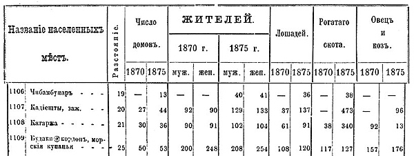 <!-- Image description: Printed statistical table giving houses, inhabitants by sex, horses, cattle and sheep in 1870 and 1875 for four places, including Кадіешты and Будаки. -->

В своем докладе Шабское волостное правление сообщало, что хутора **Чебанбунары**, **Кадиешты** и **Каторга** заселены мещанам города Аккермана и его посадов, которые пользуются землей «*по соглашениям с владельцам вотчин*».

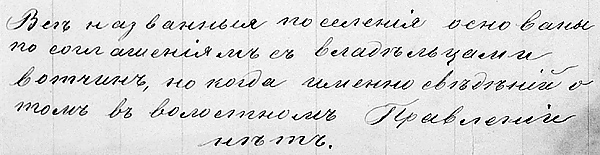 <!-- Image description: Handwritten note in pre-reform Russian: 'Всѣ названныя поселенія основаны по соглашеніямъ съ владѣльцами вотчинъ, но когда именно свѣдѣній о томъ въ волостномъ Правленіи нѣтъ.' -->

До Первой Мировой войны округа продолжалась развиваться.

На земле Софьи **Бенкендорф-Демидовой-Кочубей** возникла немецкая колония **Софиенталь** (сейчас Софиевка).

Наследники полковника Сергея Арсеньева в стороне от Шаболата основали хутор **Сергеевка** – потом там будет построена грязелечебница и основан бальнеологический курорт.

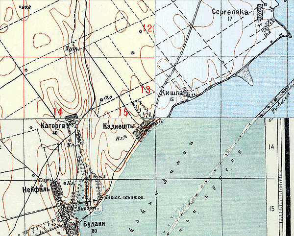 <!-- Image description: Section of a colour topographic map showing Сергеевка, Кишла, Каторга, Кадиешты, Нейфаль and Будаки on the liman shore, with a 'Детск. санатор.' marked and red grid numbers. -->

Недалеко от села Будаки богатые аккерманские армяне **Еремеевы** выкупили у наследников Демидовых большой земельный надел. Экономия Еремеевых находилась недалеко от села Каторга. (Увы, до наших дней их хутор не дошел).

В **1904** году Георгий Еремеев выделил 5 десятин земли на берегу лимана для устройства **детского приюта-санатория**.

*[Image omitted]* <!-- Image description: Printed paragraph in pre-reform Russian headed 'Дѣтскій пріютъ.—Санаторія въ селѣ Будакахъ Аккерманскаго уѣзда', about Georgy Eremeev's 1904 gift of 5 desyatinas of land. -->

Вскоре на берегу Шаболатского лимана была построена небольшая «*санатория*».

До Первой Мировой там отдыхали и лечились дети из Москвы, а во время войны долечивались раненые солдаты.

В румынское время рядом с санаторием возникло небольшое село **Попаздра**.

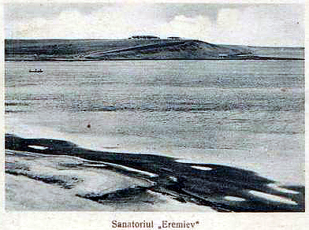 <!-- Image description: Old postcard view across the water to a low headland with buildings, with the printed caption 'Sanatoriul „Eremiev"'. -->

В советское время здесь функционировал Детский дерматологический санаторий “**Дальний**”. Тут успешно применялась бальнеотерапия местной лечебной минеральной водой, грязелечение, климато- и талассотерапия.

Увы, с начала 2000-х годов санаторий не работает.

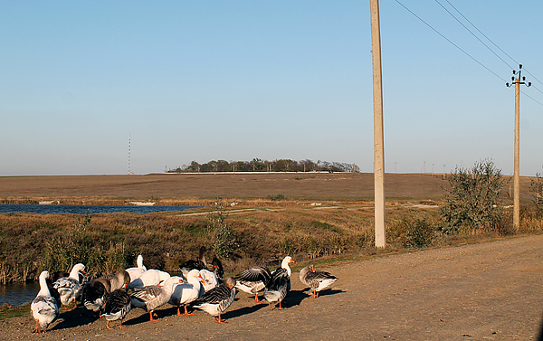 <!-- Image description: Photograph of geese on a dirt road beside utility poles, with reeds, water and a low ridge in the distance. -->

*Окончание следует…*
