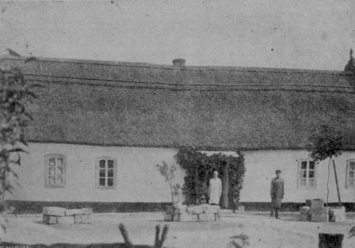
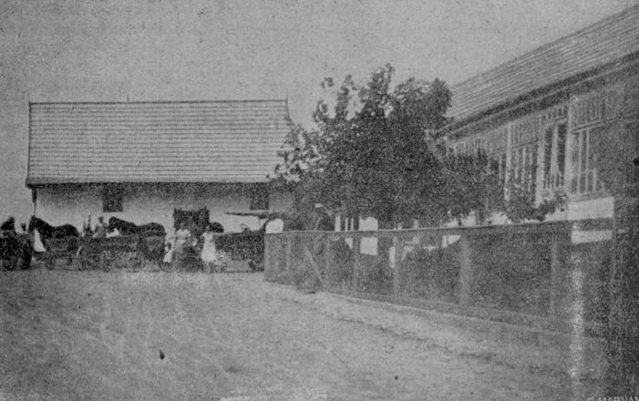
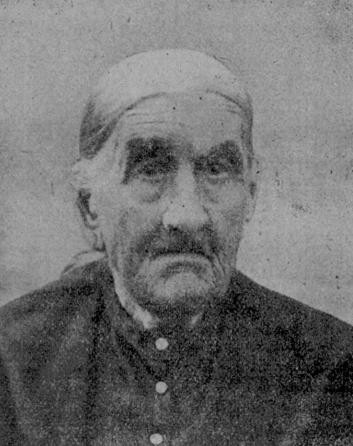
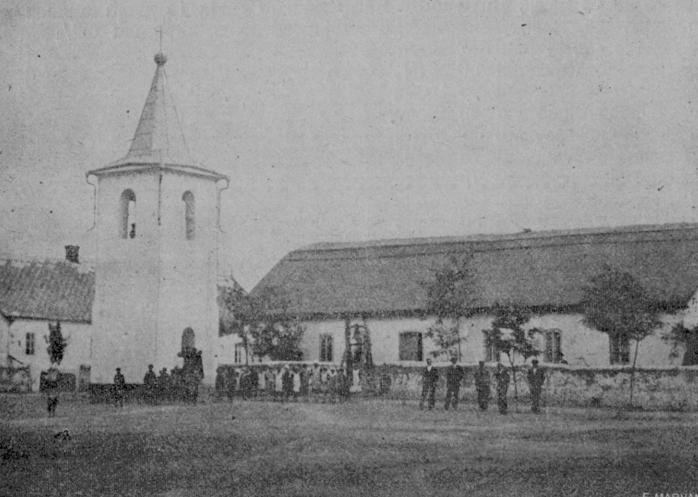
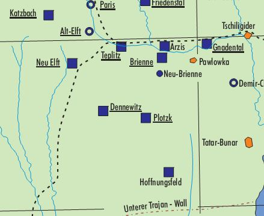

<!-- source_page: 1 -->

# History of Hoffnungsfeld

Source: *Deutscher Volkskalender für Bessarabien – 1935*  
Tarutino  
Press and Printed by *Deutschen Zeitung Bessarabiens*  
Pages 82-90  
Translated by: Allen E. Konrad  
P.O. Box 157 Rowley IA 52329  
<onamission1939@gmail.com>  
November, 2021

Source Location: http://bit.lv/21v8IWY  
Under 1935 click — urn:nbn:de:bvb:355-ubr13931-9  
Open Thumbnail & scroll for specific pages

[Note: Comments in square brackets in the document are those of the translator.]

**Weights and Measurements encountered in this document:**

- *Deßjatinen* (Deßj.)—1 deßjatin = 2.7 acres or 1.09 hectares
- *Faden*—1 faden = 7 feet or 2.1 meters
- *Kilometer*—1 km = 0.6214 miles
- *Ruble*—1 Russian ruble (1850 banco) = US 20¢
- *Lei*—1 Romanian leu (in 1870) = US$ (unknown)

---

[Translation Begins]

## History of Hoffnungsfeld Municipality

**Akkerman District (Cetatea-Alba), Bessarabia**  
**Written by Teacher Karl Balmer (deceased)**

70 years have already passed since Hoffnungsfeld was founded. The founders of Hoffnungsfeld gave their new home place a really nice name. Hoffnungsfeld means—Field of Hope. It was their hope that in their new homeland they would move forward materially and intellectually (*geistig*).

We, now even after 70 years, want to ask: Did the desire of the settlers come to fruition and has Hoffnungsfeld earned its nice name?

In order to answer this question, I would like to relate the history of our little village here.

<!-- source_page: 2 -->

In the 1860s of the last century, it became too crowded for the colonists in the old colony. Many of them emigrated and looked for a new home. For this reason, many new colonies emerged. One of these colonies is also our Hoffnungsfeld.

This small daughter colony is located 22 km southwest of Arzis, in a narrow, flat valley. The site of this small village of 1,961 *Deßjatinen* and 193 *square Faden* (*Quadratfaden*) borders Deljilier to the east, Spaska and Bakschelie to the south, and Burguji to the west and north. It is completely cut off from the German colonies.

The beautifully situated property was leased for 15 years on 30 May, 1863 from Margaretha von Almaida, daughter of State Councilor Konstantin Bachsili, who lived in Odessa. The people leasing were mostly from Neu-Elft and Wittenberg. The first settlers, who were also founders of Hoffnungsfeld, are the following persons: 1. Karl Siewert, 2. Karl Liebelt, 3. Martin Schmittke, 4. Karl Krauß, 5. Johann Kurtz, 6. Johann Siewert, 7. Gottlieb Netz, 8. Andreas Raab, 9. Peter Knodel, 10. Gottlieb König, 11. Gottlieb Knodel, 12. Johann Jeske I., 13. Jakob Thiellemann, 14. Jakob Seefried, 15. Christian Scherbinski. All of them from Neu-Elft. These first settlers came to the leased land in the Fall of 1863 and the Spring of 1864.

At the beginning of 1864, the following people from Neu-Elft were also added: 1. Johann Raab, 2. Samuel Kurtz, 3. Samuel Liebelt.

From Wittenberg: 1. Martin Sackmann, 2. Jakob Sackmann, 3. Johann Sulz, 4. Johannes Voßler, 5. Friedrich Rauschenberger, 6. Jakob Nittel, 7. Johannes Necker, 8. Joachim Necker, 9. Johann Mack, 10. Friedrich Wiedmer, 11. Andreas Keller and 12. Georg Blum.

From Alt-Elft: Christian Paul.

In 1866, also the following persons came and settled: from Wittenberg—Friedrich Schlenker and Johannes Stickel, from Neu-Elft—Johann Jeske II.

At the end of the 1860s and beginning of the 1870s, many had moved back to their old homeland and in their place the following were added:

From Wittenberg: Christ. Sackmann, Christoph Sackmann, Andreas Gewinner, Bernhard Bohnet, Joh. Sackmann, Jakob Rath, Adam Kungel, Philipp Klaiber, Peter Bohnet and Ad. Keller. From Neu-Elft: Christoph Krause and Johs. Jeske. From Alt-Elft: Wilhelm Paul and Joh. Reich. From Alt-Posttal: Konrad Bausch and Johannes Krämer and from Paris: Gottlieb Jans.

In the beginning, the people leasing lived very miserably and poorly in pitiful earth huts. It is said that when a woman arrived here with her husband and saw her new home, she burst into tears. With an almost empty hand, they arrived here and had no shelter. First thing on the list was to build a house. Building at that time was quite simple. You dug a 2-3 *Faden* wide and 4-5 *Faden* long hole in the ground, covered it with straw, soil or clay and the house, in which the dining room, bedroom and guest room were all one room, was finished. It would also have been <!-- source_page: 3 --> pointless for the people leasing to build houses out of stones, since they would not have belonged to them.

  
*Lease House (occupant Ed. Ponil)*

When in 1878 the estate of 1,961 *Deßjatinen* and 193 *square Faden* had been leased for the second time for 5 years, the following conditions were specified in the lease contract: The whole land was leased for 4,000 rubles. This sum had to be paid annually in 2 installments. In the event of a failed harvest, the people leasing had to pay only 2,000 rubles for the first three years, but the balance of 2,000 had to be paid with an additional 6% in the last two years. The people leasing were allowed to build only 5-10 stone houses on the whole land. At the end of the lease period, however, the female owner was to pay 100 rubles for each of the buildings mentioned and 25 rubles per *Deßjatine* for each vineyard and orchard. At the end of the lease period, the people leasing would be able to get it 10% cheaper than what others should offer if they had fulfilled their obligations to her. The land tax is deducted from the lease. If the people leasing broke the contract, the female owner had the right to expel them from her estate.

The above mentioned lease contract was signed on 17 May, 1878 by the following persons: And. Keller, Jak. Sackmann, Gottlieb Jans, Peter Bohnet, Christoph Sachmann, And. Raab, Friedrich Schlenker, Adam Kungel, Joh. Stickel, Joh. Krämer, Karl Jeske, Friedrich Bausch, Christ. Paul, And. Gewinner, Ad. Keller, Joh. Sackmann, And. Keller, Philipp Klaiber, Gottlieb Knodel, Ad. Sackmann, Christian Jeske, Joh. Voßler, Martin Sackmann, Jakob Rath and Gottl. Netz.

<!-- source_page: 4 -->

  
*Farmyard of Im. Baldzer*

The founders lived in these miserable huts throughout the lease period that lasted from 1864-1881. On 18 January, 1881, the land of Margaretha of Almaida was bought for 39 rubles 50 kopecks per *Deßjatin*. That comes to a total of 77,500 rubles. Of this, the buyers had to pay 29,850 rubles on 1 March, 1881, and the remaining money was postponed for 35 years. The last sum was paid only during the war time in 1915.

With the purchase of land, the history of the daughter colony Hoffnungsfeld actually began. Ultimately, when the property was bought, many had already left Hoffnungsfeld and moved out into the wide world and others, as a result, came to it. At the beginning of 1890, many wanted to emigrate and let their purchased land lie, so that the municipality was forced to draw up a municipal pronouncement in which it was decided that each of those who would move away would have to hand over their land to someone and pay 25 rubles compensation. So many who cherished the idea of emigration within themselves had to give it up now. When purchasing this estate, the following names are recorded in the letter of purchase:

1. Jakob Rath with 50 *Deßj*. and 48 *Quadratfaden*.
2. Gottlieb Netz with 75 *Deßj*. and 64 *Quadratfaden*.
3. Wilh. Baldzer with 100 *Deßj*. and 65 *Quadratfaden*.

These three men were the authorized authorities of the municipality who purchased the land in Odessa.

<!-- source_page: 5 -->

4. Joh. Stickel with 62½ *Deßj*.
5. Christ. Sackmann with 37½ *Deßj*.
6. Philipp Klaiber with 50 *Deßj*.
7. And. Keller with 100 *Deßj*.
8. Friedrich Gewinner with 25 *Deßj*.
9. Ad. Keller with 37½ *Deßj*.
10. Joh. Kalmbach with 31¼ *Deßj*.
11. Christoph Sackmann with 37½ *Deßj*.
12. Joh. Voßler with 75 *Deßj*.
13. Gottlieb Keller with 61 *Deßj*.
14. Christian Rath with 37½ *Deßj*.
15. Ad. Rath with 37½ *Deßj*.
16. Friedrich Voßler with 100 *Deßj*.
17. Jakob Voßler with 25 *Deßj*.
18. Gottlieb Knodel with 50 *Deßj*.
19. Gottlieb Raab with 25 *Deßj*.
20. And. Keller with 25 *Deßj*.
21. Mich. Wolf with 62½ *Deßj*.
22. Jakob Weiß with 25 *Deßj*.
23. Joachim Necker with 50 *Deßj*.
24. Daniel Wilske with 25 *Deßj*.
25. Andreas Raab with 25 *Deßj*.
26. Karl Schöttle with 50 *Deßj*.
27. Heinrich Schill with 75 *Deßj*.
28. Ludwig Wernick with 75 *Deßj*.
29. Joh. Mattheis with 50 *Deßj*.
30. Christian Paul with 50 *Deßj*.
31. Gotth. Siewert with 37 1;2 *Deßj*.
32. Mich. Groß with 37½ *Deßj*.
33. Christ. Lang with 25 *Deßj*.
34. Karl Hirschkorn with 37½ *Deßj*.
35. Jak. Haase with 31¼ *Deßj*.
36. Jerd. Tiede with 62½ *Deßj*.
37. Mart. Sackmann with 25 *Deßj*.
38. Elis. Reuter with 50 *Deßj*.
39. Ekat. Minderlin with 75 *Deßj*.
40. Rosina Denning with 50 *Deßj*.

  
*Oldest Woman of the Village—R. Netz*

Now that the people had bought the estate and secured their future, they sought to improve their homes. The miserable huts in which they had been able to stay for the lease period were gradually demolished. In their place arose the large and beautiful houses, which were built along the straight and 30 *Faden* wide street that stretches from north to south. The stones for these buildings were gotten from Tashlik, the wood from Kilia and the bricks from Tatar-Bunar.

In 1880-1890, the following families also came to the place: from Brienne: Ludwig Werkick, Gottlieb Minderlin and Joh. Mattheis. From Neu-Arzis: Jak. Heth and Joh. Heth. From Plotzk: Wilhelm Baldzer and from Friedenstal: Jakob Denning. In later years, Ferd. Reich, Chr. Schmiedt and Immanuel Schaupp also came. Today, Hoffnungsfeld consists of 64 Families and 322 souls.

Our little village would be much larger already if not so many people from Hoffnungsfeld had bought land in Friedrichsdorf and Parapara for their sons.

Of the founders of Hoffnungsfeld, only one woman is still alive today, namely R. Netz, wife of the late Gottlieb Netz. At the age of 88, she is also the oldest woman in our village.

<!-- source_page: 6 -->

Hoffnungsfeld makes a very good impression on travelers and strangers. The street is straight and clean. New courtyards have been measured at both ends of the village, 7 of which are already built-up.

But the house of prayer makes a less good impression. Just as the old folks built it,so it still stands today. The outside as well as the interior leaves much to be desired. In the past year, it was covered with reeds. The benches are very simple and uncomfortable. An older foot-peddle organ, which was bought in the 1890s for 300 rubles, already serves as a musical instrument. The people of Hoffnungsfeld are thinking of building a new house of prayer. May it also become a reality.

  
*Prayer House, Bell Tower and Sexton Home*

At the beginning of the founding period, the municipality used a small bell. But in 1890, two new bells were bought in Odessa. These hung on a wooden bell frame until 1928, when the municipality built a beautiful and tall stone bell tower, which together with the bell, which was bought in Pomasan in the same year, cost 88,592 lei. It forms the decoration of our village. Today, 2 bells hang on the tower, the third hangs in front of the Prayer house between two posts (*Pfählen*), which is used as a school bell.

In the first two years of the founding period, the worship service was held in a clay hut. In 1867, the above-mentioned prayer house was built, which was also used as a school hall. In addition to <!-- source_page: 7 --> the prayer hall in the same building there was also the sexton’s residence, which has now been converted into a class and teacher's room. The sexton and teacher’s residence was built in 1904.

*[Image omitted]* <!-- Image description: Oval portrait photograph of a man with a moustache, wearing a suit and tie. -->  
*Sexton Teacher R. Tschritter*

One can imagine the school lessons at that time. The school period lasted a maximum of 5 months, from the first to the last snow. At that time, religion, German reading, writing and arithmetic were taught. This was the case until 1894. In that year, the Russian state hired a qualified Russian teacher. The school situation and the school results were now significantly better. From 1894 on, Hoffnungsfeld always had two teachers. Last year, the Romanian state opened a second teaching post and appointed a Romanian teacher to it.

In the summer of 1932, under the direction of Frieda Weingärtner, the first kindergarten took place here, which also counted a very large number of children and had good results.

The following teachers worked in Hoffnungsfeld from the time of founding to the present day.

At the same time Sexton, Teacher and Secretary/clerk (*Schreiber*)

1. Friedr. Hottmann (1864-1873)
2. Friedr. Voßler (1873-1877
3. Mich. Groß (1877-1883)
4. Joh. Necker (1883-1893)
5. Joh. Fieß (1893-1895)
6. Sam. Roßmann (1895-1907)
7. Em. Flaig (1907-1908)
8. G. Dietrich (1908-1912)
9. E. Wiedmer (1912-1917)
10. Joh. Geigle (1917-1919)
11. Sam. Schwandt (1919-1920)
12. Mich. Bork (1920-1923)
13. Im. Humann (1923-1924)
14. Jak. Kallis (1924-1926)
15. Friedrich Treiber (1926-1931)
16. Theophil Weingärtner (1931-1933)
17. Rud. Tschritter (1933—)

List of Teachers from 1894 onward:

1. Rußnak (1894-1896)
2. Andr. Renz (1896-1899)
3. Fr. Grade (1899-1902)
4. Al. Ruck (1902-1904)
5. Hulenko (1904-1907)
6. Gotth. Wernick (1907-1908)
7. Ed. Thillemann (1908-1909)
8. Otto Dietrich (1909-1912)
9. E. Wiedmer (1912-1917)
10. Joh. Geigle (1917-1919)
11. O. Baumann (1919-1920)
12. Mich. Bork (1920-1921)
13. F. Voßler (1921-1922)
14. Traichel (1922-1923)
15. Gotth. Wernick (1923-1929)
16. Freidr. Treiber (1929-1930)
17. Robert Krug (1930-1931)
18. Karl Balmer (1931-1934)
19. G. Oantschea (1934—)

<!-- source_page: 8 -->

As far as the ecclesiastical service of the municipality is concerned, it was served from 1864-1876 by the pastors of the Arzis Parish, from 1876-1909 by the pastors of the Alt-Elft Parish and from 1909 to the present again by the pastors of the Arzis Parish. The pastoral service took place four times a year.

To this day, our municipality has remained a solid and closed Evangelical Lutheran congregation. In their midst there are two Brotherhood Assemblies (*Brüderversammlungen*), which are attended by almost all adults.

*[Image omitted]* <!-- Image description: Oval portrait photograph of a middle-aged man with a moustache, wearing a dark jacket. -->  
*Curator Friedrich Stickel*

Little interest is shown for education substance. Facilities for the care of science and entertainment, except for the choir, are lacking in the community. The founding of an educational association would be considered a great sin here. To date, only a few have attended and finished a middle school. So far, only two teachers have emerged from their midst, namely the brothers Gotthilf and Ed. Wernick. Mr Wilh. Keller finished the Boys’ Secondary School in Tarutino last year.

Read today are 17 copies of *Deutschen Zeitung Bessarabien*, 2 copies of *Arader Zeitung* and 1 copy of *Bessarabischer Beobachter*.

As for religious writings: *Lichter der Heimat* with 14 copies, *Bote des Friedens* with 26 copies and *Wegweiser* with 3 copies.

Since its foundation, the municipality has been administered by a village mayor, who was also the judge in disputes and other unpleasantries that occurred in his community. The mayor was strict and lawful. His orders were carried out without anything more to say. His opinion was authoritative in most cases. He was also proud of his office. Even today, the past mayors like to talk about their time as mayors. In the first years after its founding, the mayor’s office was subordinate to the District Office at Alt-Posttal. Later, it belonged to the Teplitz District Office until 1919. In that year the Teplitz Administrative Unit (*Wolost*) was abolished and since then the political community has been under the leadership and administration of a village mayor, called *Primar*, and the church congregation, since 1926, under the direction of a congregation curator. The first curator was Joh. Klaiber.

The mayors had the most difficult years in office during the time of war. According to the order of the authorities, they had to take horses, wagons, and so forth from the people. How much did a village mayor not get right and how many insults were there as a result? The men were called up and the business of farming stalled. In the war, 3 people died the hero’s death, namely: (1.) Christoph Voßler, single, son of Mart. Voßler I, (2.) Gottl. Sachmann, single, son of Ad. Sachmann and (3.) Andr. Keller, married. Joh. Voßler, single, son of Christoph Voßler, died outside of the time of the war.

But even the village elders of the post-war period had difficult years in office. The strict discipline and order was missing. The mayor (*Primar*) was no longer respected. Especially at this time in 1924, the people of Hoffnungsfeld were threatened with the danger of being expelled <!-- source_page: 9 --> by the rebellious Russians in our neighboring villages. It was determined by the revolutionaries the day on which they wanted to come to distribute the houses and the assets of the people of Hoffnungsfeld among themselves and to expel the people. Some had already prepared wagons and horses in order to be able to drive away at any moment. But where need is greatest, God’s help is closest. On that fateful day, the Romanian troops came out of Ismail and expelled the insurgents.

Since 1925, it has been a sad thing with our village administration. Since Hoffnungsfeld does not have the necessary amount of land to form a Commune, the office of mayor was taken away from us in 1925 and soon we were attached to the Bulgarian village of Delijilier, and then to Spaska and today to Burgudschi. An attempt was made to get back the mayor ship, but all the effort was in vain. Since that time, with an interruption of 2 years (1929-1931), the inhabitants of Hoffnungsfeld have had to drive 6 km to the neighboring village for every little thing and probably still be neglected there. Perhaps we will be able to get it back again in the future.

*[Image omitted]* <!-- Image description: Photograph of a large white mill building with a tall chimney, with horse-drawn wagons and a crowd of people in front. -->  
*Roller Mill*

The names of the mayors from the time of founding until the present are:

1. Joh. Jeske (1863-1865)
2. Joh. Mack (1865-1867)
3. Joachim Necker (1867-1871)
4. Andr. Raab (1871-1873)
5. Joachim Necker (1873-1875)
6. Andr. Raab (1875-1879)
7. Jak. Rath (1879-1883)
8. Gottl. Netz (1883-1886)
9. Jak. Rath (1886-1889)
10. Jak. Voßler (1889-1892)
11. Gottl. Minderlein (1892-1895)
12. Jak. Rath (1895-1898)
13. Gottl. Minderlein (1898-1901)
14. Ad. Sackmann (1901-1904)
15. Ad. Bohnet (1904-1907)
16. Joh. Paul (1907-1910)
17. Ad. Sackmann (1910-1913)
18. Joh. Paul (1913-1916)

<!-- source_page: 10 -->

19. Ad. Sackmann (1916-1917)
20. Jak. Rath (1917-1920)
21. Friedrich Netz (1920-1923)
22. Friedrich Stickel (1923-1925)
23. Ch. Paul (1925-1926)
24. Samuel Heth (1926-1927)
25. Jakob Rath (1927-1928)
26. Sam. Heth (1928-1929)
27. Ed. Bohnet (1929-1931)
28. Christ. Paul (1931-1933)
29. Jakob Rath (1933—)

The Curators since 1926 are:

1. Joh. Klaiber (1926-1927)
2. Andr. Rath (1927-1928)
3. Friedr. Stickel (1928-1930)
4. Ed. Klaiber (1930-1932)
5. Christ. Paul (1932-1933)
6. Friedr. Stickel (1933—)

*[Image omitted]* <!-- Image description: Oval portrait photograph of a young man in a suit and striped tie. -->  
*Teacher Karl Balmer (deceased) Author of this History*

The material and economic development of the community has been very good and favorable from the beginning to the present. The land is all black earth, very fertile and flat. There have always been relatively good harvests. The grain also always had good prices. Complete crop failures were in the years 1899 and 1904. A weak harvest was in 1892 and 1918. The village was hit by a cattle epidemic in 1876, which also killed many house pets. In 1892, typhoid fever disease prevailed, which also claimed many victims. But despite crop failures, cattle epidemics and diseases, the people of Hoffnungsfeld achieved well-being and prosperity.

Industry has developed relatively weakly with us. The craftsmen who had settled here soon gave up their craft and engaged in farming. In the 1890s, 1 blacksmith and 1 carpenter came here. Today, you can find in Hoffnungsfeld 3 carpenters, 2 cobblers, 1 tailor, 1 harness-maker and 1 blacksmith.

At the southern end of the village there is a mill, which is the only industrial enterprise. During the first years, the grain was ground in two wind mills and in a horse mill. The above-mentioned mill was built some time ago by a certain Daniel Stelter. It already has gone through several hands. In 1928, it was converted into a modern roller mill by the current owners Friedr. Voßler, Joh. Keller and Ed. Bohnet.

In 1925, some members of the municipality founded a store called “Hope” (*Hoffnung*). A German proverb says: “Hope does not allow to be shamed,” but the store *Hoffnung* was shamed. After three years of work, it came to grief, like many of our German businesses, it suffered a miserable collapse and had to be dissolve.

Today, Hoffnungsfeld has a privately owned store.

But the dairy business, which last year a certain Rud. Gallas from Katzbach had built here, should not go unmentioned.

<!-- source_page: 11 -->

Due to the World War, as well as the low prices of recent years, economic development was greatly slowed down.

In response to my question, which I asked at the beginning of my history, I must rightly say, according to the current state of the municipality, that Hoffnungsfeld has progressed materially and spiritually over the course of 70 years. Its work was blessed.

May it remain so in the future! May the municipality German and in faith firmly continue to exist! May the Lord add to it his protection, assistance and help!

[Translation Ends]

---

  
*Stumpp Map of Bessarabia reworked by Rolf Jethon—not in original document*
