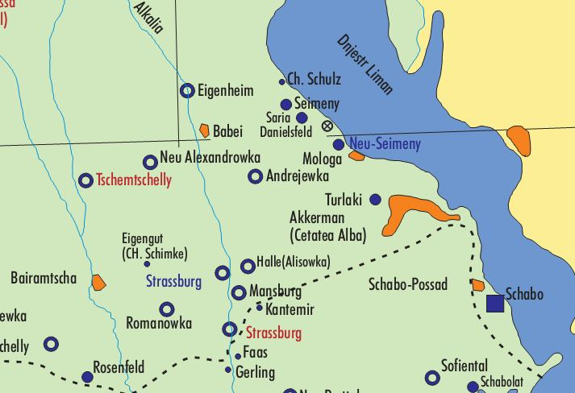
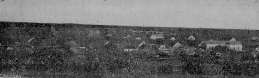
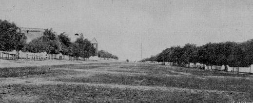
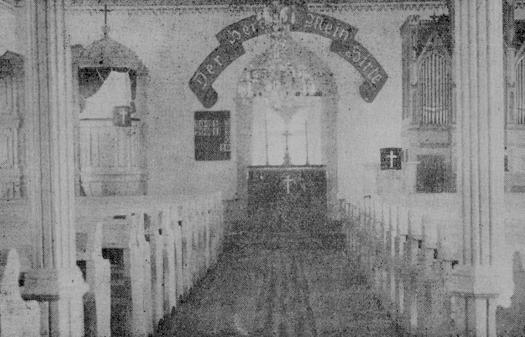

<!-- source_page: 1 -->

# History of Mannsburg

Source: *Deutscher Volkskalender für Bessarabien – 1938*  
Tarutino  
Press and Printed by *Deutschen Zeitung Bessarabiens*  
Pages 57-76  
Translated by: Allen E. Konrad  
P.O. Box 157 Rowley IA 52329  
<onamission1939@gmail.com>  
April, 2020

Source Location: https://bit.lv/21v8IWY  
Under 1938 click — urn:nbn:de:bvb:355-ubr14070-7  
Open Thumbnail & scroll for specific pages

[Note: Included in this history is a brief mention also of the nearby villages of Benkendorf, Neu-Posttal, and Straßburg I. Comments in square brackets in the document are those of the translator.]

  
*Stumpp Map of Bessarabia reworked by Rolf Jethon—not in original document*

<!-- source_page: 2 -->

[Translation Begins]

## 75th Anniversary of Mannsburg Municipality

**Cetatea-Alba District**  
(a review 1863-1938)

Just as a hiker who climbed a distant, high mountain in the golden rays of the morning sun, once again in the cooling evening air, before he steers his steps down again, overlooking the valleys and the paths of his pilgrimage from the high summit, the communities of **Mannsburg**, **Straßburg**, **Benkendorf** and **Posttal** are also on a high, noble point of their way of life this year and look back on a 75 year-long existence since the first settlers settled here to establish a new home. A look back at the past should instinctively awaken the descendants of the founders of these colonies to learn more about their origins and development, as well as about the life and development of their inhabitants. The following lines are intended to advance this desire. Recalling the old days again, this certainly has its blessing. It is useful for the youth to know what it used to be like; for the elderly, however, the past is in itself a particularly dear friend, to whom they think back again and again in quiet hours with special affection. So it will certainly serve both of them if we open up a few pages from the ancient history of the colonies. It should be said, however, that the writer is only able to give a detailed account of his home village Mannsburg, while the other above-mentioned municipalities are to be touched upon briefly with only a few strokes.

  
*Overall view of Mannsburg*

Of all the southern Bessarabian German colonies on the edge of the Black Sea, Mannsburg is the largest in terms of soul count and size. It is located in the central part of this area, in a valley trough with a gently rising mountain in the background, washed round by the Alkalia River, which is running to the south, 3 kilometers [1km=0.6214 miles] from the railway station of Dimitrie Cantemir and 25 kilometers from the district town of Cetatea-Alba (Akkerman).

Nothing could be determined about the name, i.e. why the lease settlement founded on the estate of Baron Günsburg in the late autumn of 1863 was called Mannsburg and not another or did not retain the old name Alkalia. The then leased steppe of 5,000 *deßjatinen* [1 *deßj*. =2.7 acres or 1.09 ha] bordered to the north on the estates of Countess Kankrin and General Trubetzkoi, to the south on the estate of Duchess Wolkonski, to the west on the estate of the Odessa city head, Excellency State Council Marasli, and to the east on the suburban lands of Popuschoi and <!-- source_page: 3 --> Turlaki. On 31 October, 1881, 3,000 *deßjatine* were purchased from this land area for the price of 38 silver rubles a *deßjatine*. Farmers Ludwig Knopp and August Würth were authorized to finalize the letter of purchase by the Senior Notary S. Schultz at the District Court of Kischinau. When buying the land, a mortgage of 63,000 rubles was taken out to be paid for in 43 years at an interest rate of 7½ %. The settlement initially numbered **74 Tenants**, whose names I give here after their house numbers:

1\. Daniel Isaak, 2. Johann Bauer, 3. Christian Sauer, 4. Christian Isaak, 5. Gottlieb Wutzke, 6. Philipp Elhardt, 7. Adam Ehmann, 8. Friedruch Lämke, 9. Christian Sept, 10. Karl Wolf, 11. Stephan Kurh, 12. Martin Höhnke, 13. Samuel Kuhr, 14. Wilhelm Haase, 15. Gottlieb Pfeifer, 16. Michael Hildebrand, 17. Johann Raugust, 18. Matthias Scherer, 19. Matthias Broß, 20. Wilhelm Stach, 21. David Schlechter, 22. Gottlieb Fischer, 23. Ferdinand Stach, 24. Johann König, 25. Michael Müller, 26. Karl Schulz, 27. Johann Appel, 28. Jakob Renner, 29. Christian Flaig, 30. Johann Weber, 31. Philipp Teske, 32. Gottlieb Schiewe, 33. Christian Mogck, 34. Daniel Banko, 35. Gottlieb Gläsmann, 36. Gottlieb Heth, 37. Johannes Rath, 38. Johann Beier, 39. Johann Hoffmann, 40. Gottlieb Hoffmann, 41. Konrad Herrmann, 42. Martin Döhring, 43. Michael Kraft, 44. Jakob Broß, 45. August Isaak, 46. Gottfried Bich, 47. Michael Raugust, 48. Johann Wudel, 49. Johann Thum, 50. Johann Bich, 51. Michael Bartel, 52. Gottlieb Suchland, 53. Christian Weiß, 54. Johann Neumann, 55. Heinrich Mogck, 56. Ludwig Knopp, 57. Friedrich Irion, 58. Ludwig Klaus, 59. Johann Müller, 60. Wilhelm Henneberg, 61. Gottlieb Döhring, 62. Daniel Wegner, 63. Karl Döhring, 64. Friedrich Böhlke, 65. Karl Raugust, 66. Michael Böttcher, 67. Johann Gläsmann, 68. Johann Knopp, 69. Adam Weiß, 70 Immanuel Schaal, 71. Daniel Erdmann, 72. Christoph Gutschmied, 73. Konrad Schneider and 74. Christoph Flaig.

**The 67 Buyers** are mostly different than the first leaseholders. Their names, as follow, should also be recorded on the basis of the purchase document indicating (in brackets) the quantity of land purchased:

Ludwig Knopp (90), August Würth (60), Andreas Wegner (30), Martin Sauer (60), Wilhelm Stelter (30), Wilhelm Haß (45), Wilhelm Lämke (30), Wilhelm Haase (30), Daniel Haase (30), Martin Marks (60), Gottfried Klukas (60), Daniel Bartel (39), Gottlieb Sperling (30), Johann Sperling (39), Simon Winter (30), Michael Müller (60), Wilhelm Winter (60), Michael Hinß (60), August Schulz (60), Michael Flegel (30), Gottlieb Knopp (30), August Hinß (45), Daniel Schulz (49), Johann Sauer (30), Christian Müller (50), Johann Lobe (30), Wilhelm Birkholz (60), Daniel Knopp (30), Karl Döhring (30), Daniel Müller (60), Daniel Haase (30), Johann Fried (90), Johann Radke (15), Johann Müller (30), August Manske (60), Michael Rauser (60), Samuel Böttcher (15), Daniel Mittelstädt (30), Karl Pöpke (30), Jakob Tetzlaff (30), Jakob Böttcher (45), Michael Hörth (15), Gottfried Mädche (90), Friedruch Bossert (30), Christian Mund (30), Daniel Wilske (60), Johann Reimann (90), Johannes Schlechter (60), Wilhelm Knecht (45), Karl Wolf (60), Friedrich Bröckel (60), Philipp Fey (75), Ludwig Neumann (60), Christian Kuch (40), Heinrich Kuch (35), Karl Kuch (75), Jakob Scheufele (30), Matthias Schlimmer (45), Gottlieb Suchland (90), Jakob G. Brost (25), Jakob J. Broß (20), Johann Bohnet (30), Christoph Flaig (30), Jakob Pfeifer (60), Karl Gust (30), Christoph Wudel (30) and Gottlieb Burkhard (30).

The above-mentioned settlers and buyers came mostly from the distant colonies of Kulm, Malo-Jaroslawetz 2 (Alt-Posttal), Fere-Champenoise (Alt-Elft), Dennewitz and so on. Most of them <!-- source_page: 4 --> have already died or returned to their mother colonies or emigrated to Dobrudscha and America. Meanwhile, new people, including those who came over from the Cherson *Gouvernement*, took their places. Of the former 67 buyers, only two are currently still alive: Daniel Bartel, currently the oldest man in the village, who is 85 years old, and August Manske, who moved to the Terek area (Caucasus) before the world war, lost his belongings due to the overthrow there and now, entrusted to his children, has to spend his life in Kisil in great poverty, totally blind. He was considered one of the wealthiest farmers when he moved out of Mannsburg.

In terms of property and wealth, Mannsburg finds great differences: poor, poorer, poorest; rich, richer, richest. There are a lot of landowners of hundreds or more hectares of land here, but also a lot of landless people. Since the colony was built on the river Alkalia at the very eastern border, all land is quite spread out and up to 7 kilometers far away and difficult to work as scattered sections, since the various fields are located at a great distance from the village. The condition of the land is not quite the same all over, but on average quite good, mostly black earth in a layer of ½ to 1 *arschin* [1 arschin = 28 inches or 71.11 cm] thick, with sometimes heavier, sometimes lighter admixture of black-gray sand, which is very active and fertile in wet weather, so that if there is no lack of moisture, in the ordinary way of farming, without fallow and manure, provides a plentiful yield. The better farmers make every now and then black fallow and green fallow, as well as attempts at fertilizing, and the conviction begins to become evident that the effort pays off well, if not at the first seeding, but in the next few years, because one often still sees the evidence at the fourth and fifth harvest. The vast majority, however, embrace the view that planting the fields every third or fourth year with corn or a fruit garden (*Baschtan*) (recently also with castor beans or soybeans), is sufficient to clear the weeds, especially the highly rampant wild oats (*Flughafer/Wildhafter*), the scourge of the local farmers. According to the ground design, the terrain forms a large plain or is undulating, with insignificant valley depressions, which narrow down here and there. These valleys all stretch to the Black Sea from north to south. The ground on the bottoms, which usually have more moisture, is extraordinarily fertile and the grain there is usually quite nice if it is not washed or uprooted by the field waters after rain and thunderstorms, which is by the way only in rare cases. The main occupation of the inhabitants is agriculture and cattle breeding. In 1935 and 1936, a forest, mostly made of acacia, was planted on a land area of 16 hectares [1 hectare = 2.471 acres], which has a beautiful tree growth. It is likely to be of interest as to how the harvests have been in recent years: in 1867 and 1869, the seeded fields were devastated by locusts, who, coming from mountains, came in the direction of the Bessarabian province; In 1870 grasshoppers appeared in quantity; In 1873 there was a complete crop failure, so that a bond of 1,500 rubles had to be made in Uprawa District to procure bread grain and seed grain; 1876 was a large caterpillar and beetle plague; In 1892 hail fell; In 1895 a rain flattened the beautiful grain; 1896 a weak harvest; In 1899 a complete crop failure, so that the fields simply had to be grazed by cattle; 1900 a record harvest; In 1905 the village was hit by heavy rain and a large flood, causing great damage; 1906, 1910 and 1914 yielded good harvests; 1920 weak, 1921, 1926, 1930 and 1934 good. Mannsburg was spared from animal epidemics and large fires. The local farmers own in large numbers all the necessary agricultural machines, such as single-and multi-bottom plows, drills, rake and reel mowers, self-binders and some steam threshing machines. The existing tractors “Fordson” and “Oil-Pull” have been sold partly because of their unprofitability, some of them have been decommissioned. The railway line, which runs through the Mannsburg steppe and was built in 1914, has contributed a great deal in economic terms to the uplifting and development of the village. The <!-- source_page: 5 --> proximity of the railway station D. Cantemir brought for Mannsburg not only the hustle and bustle of travel, but also the advantage that the grain could always be sold at an advantageous good prince. Thanks to this fact, great benefits are also being made from the dairy industry and the poultry farm. Many poor people of the village earn their living by hauling freight.

Mannsburg Colony has two streets about 1½ kilometers long. The old, wide lower street with 2 rows of houses is the main street. The smaller upper street with only one row of houses was constructed later. This is also a thoroughfare for all transport vehicles that travel to the railway station almost continuously, day and night. There are no pavements and drain channels, which gives the road a bleak picture after persistent rain and especially after a thaw in the spring. How the poor draft animals are being overworked and tormented to reach the final destination through the muck and mire! Apart from this cry to heaven animal cruelty, the evaporating, smelly puddle water and its swirling dust in the summer also has a detrimental effect on the health of the inhabitants of the village itself. The main street, on the other hand, has many advantages.

  
*Street view of Mannsburg*

There is less dirt and dust here. Also all public buildings are here, such as the prayer house with its bell structure, town hall (*Primaria*), bank, pharmacy and all shops and businesses. At the southern end there is a two-storey mill. The spacious houses, many of which, with their beautiful and solid construction, decorate the village and would honor even a city, are almost entirely constructed from stones or fired bricks and covered with clay roof tiles or cement roof tiles; only on some houses with cane roofs can you still see the traces of the old times. Since the ordinary wells contain saltpeter, undrinkable water, some artesian boreholes were dug on the main street in the pre-war period, which at a depth of 56-60 *Faden* [1 faden = ca. 7 feet] give good and abundant water, with which one is very satisfied. During the settlement, the Alkalia River was well suited for bathing, abundant in fish and abundant in water, but presently, it is so muddy in many places that it partially dries up in the hot season. There is an urgent need to change things here.

At first, Mannsburg was administratively subordinated to the regional office (*Gebietsamt*) of Malo-Jaroslawetz II (Alt-Posttal), from 1873 to 1919 it belonged to the Neu-Posttal *Wolost* and for some years it has formed an independent local government with the surrounding villages of <!-- source_page: 6 --> Marazlaveni, Marianka, Straßburg, Alkalia and Kantemir, which has its seat in Mannsburg. In 1934, a special administrative building was built here for this purpose, which meets all the requirements of modern times. As you can see in our picture, it is a stately building, which came to cost 150,000 lei. In the autumn of 1936, the new building had the misfortune that the bank safe, with securities and lots of cash, was stolen and has disappeared without a trace to this day.

*[Image omitted]* <!-- Image description: Photograph of a long tile-roofed building behind trees and a fence with brick gateposts. -->  
*Administrative Building in Mannsburg*

Mr. Reinhold Tschritter is currently in office as **Mayor** (*Primar*). His predecessors were: Gottfried Sperling and Jakob Eckert.

Since its foundation, the following men have governed here as **Village Mayors** (*Dorfschulzen*):

Christian Mogck, Jakob Pfeifer, Johann Thum, Ludwig Knopp, Johannes Mogck, David Schlechter, Gottlieb Gläsmann, Gottlieb Suchland, Johann Müller, Daniel Wilske, Johann Reimann, Matthias Mehl, Georg Schmauder, Wilhelm Winter, Christian Simon, Johann Bohnet, Johann Lobe, Jakob Rivinius, Gottlieb Schimke, Daniel Buchfink, Johannes Handel, Jakob Eckert and Johannes Koth.

The municipality of Mannsburg has had a number of capable leading men. Ludwig Knopp, Christian Simon, Georg Schumauder and Jakob Eckert played a particularly prominent role. Peter Mutschler, who over the course of three decades worked for the benefit of the community and the general Germanism in Bessarabia in the ethnic, political and economic spheres, and held various honorable electoral offices, developed an extraordinarily successful effectiveness. During the Russian time, he was for many years a delegate (*glasnvi*) of the District Landscape <!-- source_page: 7 --> meetings (*Kreislandschaftssitzungen*), from 1912 to 1916 a member of the *Uprawa*, from 1913 to 1916 member of the District Land Establishment Commission (*Kreislandeinrichtungskommission*), “*Sschodmann*” of the *Wolost* until the dissolution of the territorial offices in 1918. After the war, he was a member of the People's Council (*Volksrats*) until 1933, deputy parliamentarian 1922-1926, president of the District Chamber of Agriculture 1927-1929, first chairman of the Agricultural Association (*Landwirtschaftlichen Verein*), co-founder and administrative member of the public limited company “Bad Burnas,” founder and first chairman of the educational association “Orion,” the Mannsburg Bank, the consumer association “Ökonom,” etc. In recognition of his great merits, he was awarded the honorary title of a college council by the Russian authorities and he was awarded the silver medal “for service zeal” with the Alexander Troop (*Alexanderbande*) and the Stanislaus Order 3rd Class. From the Romanian state, he was decorated with the Order of “*Coroana Română*” in the ranks of an officer. I would like to mention that Mr. Mutschler gladly and willingly put his knowledge and powers at the service of his community. His judgment, based on experience and convictions, always fell into the pan of the scale (*Waagschale*) as important. One had to, as he was at home in all the behaviors and observances like no other. The purchase of our magnificent church organ, the construction of the new bell structure, the cemetery wall, the administration building, the artesian wells, the forest complex and many others, are the fruits of his deliberate and thoughtful advice. But he also took care of the well-being of the school. By establishing the “*Semstwo* School” in the capacity as a member of the *Uprawa* at the time, he has set himself a lasting monument, and thus deserves unforgettable thanks from the present and future generations. One will say here, as the emissaries of the centurion of Capernaum dared say: “He is worthy that you do this for him, for he also built the school for us.”

*[Image omitted]* <!-- Image description: Portrait photograph of a middle-aged man with a moustache, in a suit and tie. -->  
*Peter Mutschler, Parlamentarian and holders of various electoral offices*

*[Image omitted]* <!-- Image description: Photograph of a prayer house with arched windows beside a tall square brick bell tower topped by a cross. -->  
*Prayer House in Mannsburg*

<!-- source_page: 8 -->

  
*Prayer House Interior*

In the first period of settlement, the goods house (*Gutshaus*) was used for church and school purposes. In 1888, the present Prayer House was built, which does not try to be like the proper village churches of our colonies when it comes to the area of space, but nevertheless, today does not quite suit its purpose, since it does not hold all churchgoers by far anymore, especially on the big festival days. In 1924, in the place of the old wobbly wooden bell structure, a new massive fired brick one was put up, as is visible in the picture.

Also, in 1908, the old Schiedmayer pedal pump organ, which had become unusable, had to give way to a new full sounding organ from the K. and K. Hoforgelfabrik of the Rieger brothers, Jägerndorf, formerly Austria Silesia. The church congregation of Mannsburg belongs to the Neu-Posttal Parish and has been served spiritually since the foundation by the following **Pastors**:

1\. Georg Behning (1864-1868), 2. [Gustav] G. Schomburg (1868-1877), 3. Ludwig Katterfeld (1877-1879), 4. [Christian August G.] Naumann (1879-1890), 5. Johannes Alber (12 May to 12 October, 1880), 6. Julius Peters (1880-1883), 7. [Samuel] Eck (1883-1885), 8. Johann Golwer (1886-1895), 9. Wilhelm Beck (1895-1897), 10. Oskar Schneider (1897-1902), 11. Woldemar Jürgens (1902-1909), 12. Julius Peters (1909-1912), 13. Wilhelm Meyer (1912-1919), 14. Albert Schön (1919-1922), 15 Siegfried Wolleydt (1922-1924), 16. Adolf Härter (since 7 September, 1924).

The following people have been active in the municipality of Mannsburg as **Sexton-Teachers** (*Küsterlehrer*), who, until 1919, at the same time also served as the **Municipality Clerk**:

1\. Karl Raugust (1864-1865), 2. Wilhelm Baisch (1865-1866), 3. Gottlob Kludt (1866-1867), 4. Jakob Roch (1867-1877), 5. Johannes Göhring (1877-1878), 6. August Würth (1878-1884), Eduard Beck (1884-1889), 8. Gottfried Kuck (1889-1895), 9. Joseph Enßlen (1895-1908), 10. Eduard Roßmann (1908-1911), 11. Rudolf Dieno (1911-1919), 13. Johannes Mauch (1919-1920) and 13. Johann Haag (since 1920).

<!-- source_page: 9 -->

As far as church life is concerned, the well-attended worship services are to be emphasized. The most diligent churchgoers are the “Hour Brothers and Sisters” (*Stundenbrüder und Schwestern*). Of course, weeds grow among the wheat at all times, and there is no lack of hypocritical pietists and self-righteous Pharisees, but they are largely sincere, serious Christians. The sectarian system, which spread as a result of religious ignorance a few years ago, has at present melted down to one family of the so-called “Evening Lights” (*Abendlichter*).

A piece of the history preserved in the government archive can provide information about the former service relations of the sexton-teachers, which I reproduce here in full:

> **Agreement concluded between the Malojaroslawetz II [Alt-Posttal] colonist Gottlob Kludt and the municipality of Mannsburg.**
>
> 1. The Malojaroslawetz II colonist Gottlob Kludt takes over the service of a school teacher and parish clerk in the colony of Mannsburg from 1 May, 1866 for 1 year and undertakes to provide these services in all respects to the satisfaction of the community and the mayor’s office and to lead an honorable way of life.
>
> 2. For what was said in the first point, the Mannsburg municipality promises him a remuneration annually of 150 rubles silver, besides additional: 20 kopeks for a baptism, 30 kopeks for a funeral, 15 kopeks for the vaccination of a child, 6 kopeks for a statement of liability, 1 kopek per ruble of an inventory loan (*inventarische Aufnahme*), 40 kopeks for a contract; free residence and fuel, as well as a well, cellar and stables; likewise, the same will be allowed 4 head of horned cattle to be driven to the pasture free of charge; he also gets 5 *dessjatinen* of excellent, good hay field, which must be worked by the community, hauled home and put on the haystack, as well as from each farmer one *pud* [1 pud = 36 lbs or 16 kg] and from each resident half a *pud* of clean (*reinen*) wheat (Arnaut).
>
> 3. Both the school teacher Gottlob Kludt, as well as the municipality of Mannsburg and the mayor’s office are obligated to give notice a quarter of a year before the end of the year of service if one or the other intends not to enter into the above conditions any more.
>
> 4. If there is agreement on the part of school teacher Gottlob Kludt, as well as the municipality of Mannsburg and the office of the mayor, to sincerely and precisely do this, then let school teacher Gottlob Kludt and the municipality deputies confirm it by means of their handwritten signature and the office of the Mannsburg mayor sign and place on it the Crown seal.
>
> This happened in Mannsburg Colony, 24 February, in the year of our Lord, 1866.

Mannsburg possesses 2 schoolhouses: The community school, consisting of 2 classrooms, was built in 1891, from funds raised by self-taxation of the members of the community. The single-<!-- source_page: 10 -->class *Semstwo* School of 1914, together with a teacher's residence, which Mannsburg has to give thanks to the initiative of the community member Peter Mutschler, who was then a member of the District Landscape Administration. As can already be seen from the picture, this school site is extremely appropriately furnished. The lighting and airy conditions meet all the requirements that are placed on a school building in hygienic terms today. The school benches are also throughout two-seated and completely new systems, and numerous visual aids and geographical maps decorate the walls of the classes. In the past school year, 80 boys and 86 girls attended the same school, which has one German and two non-German state-paid teachers.

*[Image omitted]* <!-- Image description: Photograph of a long single-storey schoolhouse with two chimneys and a hipped roof, behind a low stone wall. -->  
*State School at Mannsburg*

As **Teachers** of national language instruction, the following persons worked at the school in order of service:

Christian Gerling, Peter Mutschler, Robert Singeisen, Theodor Wagner, Emanuel Gutsche, Otto Enßlen and Artur Gander at the time of Russian rule and Otto Keller, Walter Baisch, Georg Rietmüller, Jakob Semmler and Johannes Haag in the post-war period. The latter is also currently in office and also holds the directorship of the State School.

From the following list it can be seen that the farmers of today value education and strive to give their children more school information on the way of life than they themselves received.

Coming from the municipality of Mannsburg:

1. **Two Academics:** Eduard Knopp, deceased, as doctor in the *Semstwo*-hospital at Akkermann, and Jakob Rivinius, at the moment pastor in the Leipzig Colony.

2. **Eleven Diploma Teachers:** Wilhelm Anklam, deceased, formerly in the Don District; Johann Kison in Halle (Alisowka), presently in the U.S.A.; Eduard Klukas, deceased, in the Caucasus; Johannes Anklam, deceased, in Alt-Posttal; Johann Knopp, currently tax office <!-- source_page: 11 --> inspector in Bairamtscha; Otto Enßlen, in military service; Emil Buchfink, presently in Wittenberg; Benjamin Hartwig, presently in Neufall, Artur Schumauder, presently in Andrejewka; Artur Schlechter, presently in Eigengut-Schimke and Alexander Eckert, at this moment in military service.

3. **Two Graduates from Middle School:** Alexander Mutschler—Akkerman School of Commerce, presently bank accountant and reserve lieutenant and Emanuel Kanke—Tarutino Boys’ School, merchant.

4. **Four pupils at the Großliebental Central School:** Johann Rivinius, Emil Anklam, Nathanael Reimann and Wilhelm Hinß.

5. **Eleven pupils at the Sarata Werner School:** Eduard Anklam, Christian Flaig, Gottfried Stach, Richard Reinig, Artur Bohnet, Emil Rivinius, Hugo Simon, Reinhold Koth, Gerhard Eckert, Hugo Hinß and Daniel Kroisandt.

6. **One pupil at the Akkerman Commercial School:** Rudolf Mutschler.

*[Image omitted]* <!-- Image description: Oval portrait photograph of a young man in a dark buttoned student uniform. -->  
*Dr. Eduard Knopp, deceased, as a high school student*

*[Image omitted]* <!-- Image description: Oval portrait photograph of a young man with a moustache in a dark buttoned student uniform. -->  
*Pastor Jakob Rivinius as a high school student*

7. **Five girls** were trained in various secondary schools, but only one pupil, Klara Enßlen, née Faas, the author's wife, completed a full 8-class secondary school (*Lyzeums*).

8. **At present**, only three local children attend schools away from home: Ernst Radke and Siegfried Höfel attend the Tarutino Boys Secondary School and Linda Haag the Sarata Werner Training College.

Newspaper reading also contributes to the further education of the local population. In addition to our home newspapers: *Deutsche Zeitung Bessarabiens*, *Deutsches Volksblatt* and *Der Sonntagsgruß*, which are obtained in considerable numbers, some copies of the large daily <!-- source_page: 12 --> newspapers from the other settlement areas of the country (Transylvania and Banat) have also found their way here; which, however, is still quite insignificant in relation to the number of souls of the village and does not only testify to scientific alertness, but the need for spiritual nourishment grows from year to year. There are also some hard-working book readers. In addition, there are already some good books in the village. The local public library already contains 842 volumes.

The **Society Movement** is still in its infancy here. The activity of the educational association “Orion” consists mainly in the respective organization of theater evenings and dance evenings in the winter months. The wind instrument chorus “Akkord,” which is made up of 20 instruments and led by Mr. Alexander Mutschler, is very effective. Among other things, he had the honor of helping to beautify with his snappy music performance the inauguration festivities of the Baden Institute in Burnas in the summer of 1926 and the Bessarabian Farmers' Day in Arzis in the autumn of 1936.

*[Image omitted]* <!-- Image description: Group photograph of a mixed choir of men and women, standing and seated in rows. -->  
*Mannsburg Choral Choir*

*[Image omitted]* <!-- Image description: Group photograph of a brass band of men holding their instruments. -->  
*Mannsburg Wind Instrument Chorus*

Apart from the setting up of May trees and egg-gathering at Easter, no old **Customs and Practices** are paid attention to any more. There are also no more special national costumes (*Trachten*) besides some Saxon ethnic costumes that have recently been adopted. Most people of the younger generation wear what is urban, and it often happens that one sees among the female gender real twitching figures, who simply do not understand how to reconcile their behavior with the clothing fashion, so that, despite their outward appearance, the peacock foot can be noticed at every step.

*[Image omitted]* <!-- Image description: Group photograph of schoolchildren with several adults, standing in rows in front of a building. -->  
*Student group of Mannsburg, left teacher J. Haag, director of the school*

<!-- source_page: 13 -->

*[Image omitted]* <!-- Image description: Photograph of a large crowd gathered in a cemetery, with a wall and a cross in the background. -->  
*Mannsburg Cemetery Consecration*

Mannsburg has two cemeteries: one old and one new. The latter, however, proved too small to accommodate more dead; it was therefore enlarged in 1934 and surrounded with a new stone wall, which looks quite nice. A high curved arch with a solid iron gate forms the entrance. Above it are two gilded inscriptions—on the outside: “A Rest is on Hand” and—on the inside: “I am the Resurrection and the Life.” The graves are usually decorated with stately tombstones and carefully maintained. Many are framed with iron fences (*Gittern*). Everyone, whether rich or poor, does as much as he can for his dear deceased, and no one wants to be inferior to the other. Hardly has spring arrived, then everyone thinks of his small spot in the cemetery (*Kirchhof*) and cleans up his graves and plants flowers. Although there is much to be desired in Mannsburg in some matters, but as far as the cemetery is concerned, it can be quite proud in this respect and be a role model to many a colony. For a number of years, a celebration has been taking place here in the cemetery on Easter morning. Very early, around four o'clock, the sound of the bell is heard with the invitation: “Come to the graves of your loved ones!” The population flows into God’s Acre (*Gottesacker*) in great numbers. Half an hour after the first ringing of the bell, the bells are rung together—the signal for the beginning of the celebration. There is dead silence among those gathered, while shortly before that some greetings of “Happy Easter” (*Frohe Ostern*), “Happy Easter” (*Fröhliche Ostern*), “Blessed Holidays” (*Gesegnete Feiertage*) are exchanged. Usually, the celebration is started with choral singing, whereupon some verses of an Easter hymn are sung, accompanied by the music band. Then the sexton reads the Easter Gospel. This moment usually coincides with the rising of the Easter sun. Then comes a touching speech to penetrate the hearts of the audience, for which the many tears that are wiped from the cheeks provide proof. The celebration concludes with prayer, singing and brass instrument music. The hearts of men are gathered more than usual this morning, because firstly, through the past “silent week” (*stille Woche*), the business spirit has already moved more in this direction, and secondly, this place already inspires serious thoughts within the soul. In short, the Easter celebration in the cemetery always has its beneficial effects and it is to be hoped that it would take place everywhere.

The population of the municipality of Mannsburg is 198 families of 894 souls, of which 436 are male and 458 are female. The number of people born since its foundation is 2,544 souls, including 1,300 boys and 1,244 girls. 1,260 souls died, 650 male and 610 female. The highest number of births was recorded in 1876 with 53 newborn, the lowest number of births in 1926; the number of births thus averages 34 per year. The highest number of deceased was 48, in 1873, and 5 the lowest number in 1890; the median number of deaths comes to 17. Seventeen people have lost their lives as a result of various accidents, namely:

<!-- source_page: 14 -->

1. **Karoline Heth,** 23 years old, died on 17 June, 1868 due to blood poisoning after being wounded by a scythe.
2. **Michael Broneske,** 24 years old, drowned on 16 July, 1870 while swimming in the Black Sea in the vicinity of Balabanka.
3. **Maria Gläsmann,** 5 year old child, drowned in a well on 8 July, 1875.
4. **David Schlechter** died on 16 January, 1876 while on the way from Odessa on the ice of the Djestr estuary near Akkerman where he was attacked and strangled by a gang of robbers.
5. **Barbara Renz,** née Faas, 19 years old, died on 25 August, 1892 after falling from a wagon.
6. **Margarethe Fr. Schmauder,** 2 year old child, burned to death on 7 July, 1894.
7. **Christine Sperling,** née Jaßmann, 42 years old, died on 4 January, 1898 when she fell from a ladder.
8. **Jakob Jeß,** 38 years old, froze to death while on the highway on 12 February, 1899.
9. **Johann Maas,** 13 year old youth, fell off a fully loaded grain wagon and died on 13 July, 1900.
10. **Franz Edinger,** a 22 year old feeble-minded youth drowned in a brook on 29 May, 1913.
11. **Sophie Sperling,** née Meilke, 26 years old, while fetchhing water, died at the artesian well in 1916 when knocked down by the water-drawing apparatus (*Schwaungrad*).
12. **Johann Knecht,** a husband at the age of 34, died on 2 October, 1918 when he hung himself.
13. **Gustav Geißler,** 15 years old, died on 23 April, 1919 from an accidental gunshot wound.
14. **Jakob Arnold,** 22 year old, was mortally wounded in a fight on 4 June, 1919.
15. **Ide Joos,** 16 year old girl died on 26 June, 1927 when buried alive in a clay pit.
16. **Adam Flaig,** a 37 year old family father, on 29 July, 1932, in the hectare village of Cantemir, on the way home from Halle, was crushed by a wall while seeking shelter in a cottage during a pouring rain.
17. **Olga Sukkut,** 24 years old, died on 29 April, 1934 as a result of a fall.

**World War I** claimed the following twelve victims:  
**a. Those Killed on the Battlefield:** Johannes Schimke, Gottfried Klukas und Friedrich Daffe;  
**b. Those Missing in Action:** Wilhelm Winter, Gotthilf Stach und Benjamin Döhring;  
**c. Those who died in Military Hospitals:** Johannes Tschritter, Jakob Buchfink, Eduard Anklam, Rudolf Bartel, Georg Gebhardt und Jakob Chr. Flaig.

Hopefully, the municipality of Mannsburg will not fail to erect a proper monument to its sons who fell victim to the World War.

Important events to be noted: a church visit in 1892 by Bishop Freidfeld from St. Petersburg, accompanied by Provost Rudolf Faltin from Kischinau. 1896 visit of the then Bessarabian <!-- source_page: 15 --> *Gouverneurs* Konstantinovich on the occasion of the solemn inauguration of the spring, which is flowing from the Alkalia River and was excavated and covered with a structure as part of an emergency operation to provide service to the starving population. In 1896, General-Superintendent Pingoud from St. Petersburg held a parish meeting, whose objective was the formation of the Eigenheim Parish. In 1911, General Superintendant Pingoud came along with recently Provost Johannes Alber from Großliebental traveling through Mannsburg, where the honorable guests were welcomed by Mr. Peter Mutschler in the name of the village and the representatives of the surrounding communities. This trip was related to the filling of the vacant Posttal Parish by Pastor Wilhelm Meyer. In 1921, the municipality of Mannsburg gathered at the Dimitrie Cantemir railway station to greet King Ferdinand I, who was passing through the district town of Cetatea-Alba and received a meal (*Salz und Brot*) by the then *Primar* Jakob Eckert and had a favorable conversation with several elderly people. On arrival and departure, the sovereign guest was greeted with brass music. In the past year of 1937, at the occasion of the building of the stately triumphal arch at the railroad station, 150 flagged riders of the municipality stood in formation on the main road near Schabo when His Majesty King Charles II was passing through.

On Pentecost Monday 1937, the first “Labor Day” was held in Mannsburg by the Bessarabian Administrative District Council (*Gaurat*) in the presence of the Administrative District Headman Dr. Otto Broneske. From 23 to 25 May, 1937, a Bible course was held in Mannsburg, led by Senior Pastor Immanuel Baumann and Pastors Gotthold Winger, Adolf Härter, Albert Kern, Jakob Rivinius, August Hermann and Evangelist Emil Hommel.

**Trade, Industry and Crafts** are represented in Mannsburg as follows: Instead of the Consumer Association “*Ökonom*,” which existed in 1902-1918, trade is currently in the hands of 4 small traders. Industrial enterprises are: 1 modern roller mill with engine operation, 1 grist mill, 2 oil crushers, 2 roof cement tile works, 1 brick kiln, 5 cobblers, 5 tailors, 4 butchers, 7 blacksmiths, 5 carpenters, 1 cooper, 1 restaurant, 2 dairies, 1 guest inn, 2 warehouses. The firm G. Winter and Company is particularly large in size, which works purposefully and successfully. The business premise, which is no different from an ordinary farmhouse, one does see what transactions are made in the same, a little apartment (*Stübchen*) that gives more the impression of a village administrative building.. The owners of the company are untrained but practical farmers who benefit professionally and know how to preserve their benefits. Hats off, respect for them!

*[Image omitted]* <!-- Image description: Photograph of a tile-roofed bank building with a chimney, behind young trees and an iron fence. -->  
*Bank building of the “Mannsburg Bank”*

**Banking** is based on 2 institutions: Volksbank “Minerva,” established 1925, and “Mannsburg Bank, A.G.,” established 1906.

In the so-called “Lower Colonies” of southern Bessarabia, where land fever was more than anywhere else at the time, where all the cash was put into land purchases, where the <!-- source_page: 16 --> business is always set up as large as possible, not only weak harvests put the fellow countryman in a difficult position, not to mention the total crop failures, against which he is helpless and defenseless, without a doubt there existed, as a rule, the need for money. In such circumstances, it has long been felt as an urgent need to have its own credit institution. Some courageous men therefore came together and founded on 7 October, 1906, a “Loan (*Leih*) and Savings Fund Company (*Sparkassengesellschaft*)” with its headquarters in Mannsburg. Even so, at this time when the Fund was opened, there was no great lack of money among the people, thanks to the beautiful harvest in 1906, which brought everyone more money than they needed at the moment, so the establishment of the Fund was greeted with joy. From all the villages of the activity sphere of the Fund (the *Wolost* Posttal, Eigenheim and Nadejdea), the farmers in turn joined it.

*[Image omitted]* <!-- Image description: Photographic tableau of twenty-two small portraits of men in three rows, framed with flowers beneath a lettered banner dated 1906–1911. -->  
*Administration of the Mannsburg well managed Credit Association at its 5 best years (1906-1911)*  
***Top Row:** Jakob Broß (Mannsburg). Gottfried Schulz (Alisowka), Gottfried Götz (Tarutino), August Koth (Basyrjamka), Jakob Rivinius (Mannsburg), Gottlieb Schulz (Seimeny), Jakob Enßen (Negrowo-Friedensfeld), Georg Wiedmann (Romanowka).*  
***Middle Row** Gotthilf Eckert (Alisowka), Johannes Dietrich (Sofiental), Georg Schmauder (Mannsburg), Peter Mutschler (Mannsburg), Josef Enßlen (Mannsburg), Eduard Roduner (Akkerman), Samuel Bohnet (Alisowka).*  
***Lower Row:** Gottfried Klukas (Mannsburg), Friedrich Anklam (Mannsburg), Friedrich Hanschke (Neu-Posttal), Christoph Fischer (Neu-Posttal), Jakob Eckert (Mannsburg), Emil Eckert (Eigenfeld), Karl Beierle (Benkendorf).*

As of 1 January, 1907, the company already had 150 members with a base capital (*Grundkapital*) of 13,000 rubles and a turnover of 50,000 rubles At the end of the year, there were already 350 members with share-holder capital (*Eigenkapital*) of 26,000 rubles and a turnover of 175,000 <!-- source_page: 17 --> rubles. A bad circumstance accompanied the first half of this year of operation. A significant amount of money had accumulated, which could not be invested profitably. But the page turned very soon. Even before the harvest and even more after the threshing, many loans were taken. The many land purchases that were completed at that time and which were unprecedented in terms of both the area and the amount of the prices paid, greatly diminished the amount of money in the Fund. Nevertheless, it has never lacked money. People came from everywhere who wanted to put their savings in a place of safe investment, as the Fund paid quite nice interest. A company whose members have 27,000 *deßj*. of land, which was worth about 7 million rubles, could probably be considered creditable. In 1908, the Loan Fund Company and Savings Fund Company was transformed into a Mutual Credit Company, which in 1912 already had 733 members, whose total assets amounted to 25 million rubles, consisting exclusively of purchased land. The annual turnover amounted to 22 million rubles, with a net profit of 23,000 rubles, which, as every year, was partly invested as a stock capital (*Vorratskapital*), partly paid out as a dividend to the members and partly for cultural activities and charitable purposes. The main focus was on the Tarutino Secondary Schools and the Central Schools at Sarata and Großliebental. It should be noted that at the time of the biggest monetary crisis, the Mannsburg Bank only increased the interest rate by 1 percent, also with the highest standard. Thus only a secure, well-founded and solidly guided enterprise could act, and all learned invaluable benefits, which its enemies, the usurers, had to admit. Due to the unexpected outbreak of the World War, the bank suffered enormous losses and therefore, in the post-war period, had to be transformed into a stock company in 1924, in which form it still exists today. The so-called Conversion Law has recently hit the bank hard because 95 percent of its debtors are farmers, 80 percent of whom took advantage of the debt restructuring. This resulted in a deficit of 1½ million lei, which was caused by the reduction of half of the debt. Fortunately, however, this shortfall was recouped by an agreement with the creditors, leaving the stock capital of one and a half million lei untouched with the reserve fund of 372,000 lei. In conclusion, we can therefore stress that the Mannsburg Bank meets a real need and its destiny, is certain, is in faithful hands and one can predict its prosperous effectiveness in the future! However, there are still hostile persons who have to suspend the activities of the bank management of some people and who believe themselves to be appointed director, without thinking of the effort, danger and responsibility, yet still completely forgetting who initiated the matter and even now is still the soul, the real driving force of the whole.

At the entrance to the Prayer House, there were large gilded letters saying, “I will give peace in this place!” This saying has been omitted from the entryway (*Vorhaus*) of the new building, perhaps not without reason, because, since then, peace in the life of the community has also disappeared. Hatred, envy and resentment, these disgusting parasites of all agreeable coexistence, have become more and more widespread in recent years. Small causes, large effects!....Men, who today could do a lot together to promote the community’s well-being, fight each other, get into each other’s hair, and eye something when another person does not. And why? What is the cause? Often it is hurtful vanity, often resentment and envy, that the other enjoys apparent advantages, which one thinks to be deprived of for one’s own person, often selfishness, coupled with stubbornness and irreconcilability, which have a disturbing and destructive effect on the life of the community, and the whole of society carries the damage. If you want to be overwhelmed, you only have to attend a community meeting, which almost always resembles a stormy lake. Sad, but true!

<!-- source_page: 18 -->

*[Image omitted]* <!-- Image description: Oval portrait photograph of a man in a suit and tie. -->  
*Otto Enßlen, teacher, military service, author of this history*

And so we are saying goodbye to the people of Mannsburg, wishing that the community of Mannsburg will continue to develop and, in all existing party disputes, improve and grow and prosper in harmony and peace for the benefit and godliness for the child and the child’s child.

After having passed in detail before our eyes the history of the municipality of Mannsburg, we now take a look at the other jubilees and begin with **Straßburg I**, which received the official name Alcalia, apparently because it is located on the small stream of the same name below the railway line, about six kilometers [3.7 miles] from Mannsburg. At the time, the land was the property of the former District Nobleman Marshal Nawrotzki. The first tenant was the Friedenstal settler Friedrich Renz, who bred excellent fattened cattle and large herds of sheep, which were kept outdoors almost all year round. Later, the estate was administered by the brothers Wilhelm and Jakob Föhl. With the Agricultural Reform, it was distributed to landless people, recruited from representatives of all nations. The greater part, however, are Germans, but they are very poor. They do not posses either a prayer house or school building. State school instruction is held in a private home. Church worship and teaching in the mother tongue are very neglected because one is not able to hire a teacher without outside assistance. At present, the German population consists of 222 souls.

**Benkendorf**, with 466 souls, 8 kilometers [5 miles] from Mannsburg and also located in the Alkalia valley, was originally owned by the Duchess Kotschubei and afterwards the Countess Demidowa, née Benkendorf. From a more precise description of the origin and development of this community, it should be noted that this place became widely known through a private school, which was set up at that time in the wooded estate near the village by Pastor G. Schomburg. First here, then in Akkerman and most recently in Katherinenstadt an the Volga, he prepared young people to enter a grammar school (*Gymnasium*) and, where possible, to study at the university. Some of these young men have been sexton-teachers in the colonies for a few years, later studied theology in Dorpat and then situated in the pastoral office, for example, Pastor J. Jundt. Others have remained sexton-teachers or become clerks and have shown themselves to be very capable in service, as for example, Immanuel Böpple, so that the activity of Schomburg for church and school in the south was of no small blessing. We honor the blessing with the wish that the people of Benkendorf would once again have a Schomburg for their school, which they would have so much need of for their school children, even if the education system is no worse for them than in many other German villages in our Bessarabian settlement area.

<!-- source_page: 19 -->

*[Image omitted]* <!-- Image description: Photograph of a large brick church with a tall pointed steeple and arched windows. -->  
*Church at Neu-Posttal*

Now we turn to **Neu-Posttal**, which is 5 kilometers [3 miles] east of Benkendorf. In the vernacular, it used to be called “Staraja Potshta.” The name originates from the old post house, which the first tenants still encountered. The land was once owned by Count Demidov and was purchased in 1880. In Russian times, it was the seat of the *Wolost* administration and church parish village. It is still the residence of the pastor today. The residents are mostly wealthy farmers with charming and comfortably furnished houses. In addition, there are two well houses and a large pond in the middle of the village, which are excellent for bathing for both people and cattle. Posttal has a doctor, a veterinarian, a cooperative, a brickworks, a clubhouse build in rough brick, an old schoolhouse with a wooden bell structure, a well-kept cemetery surrounded by a stately stone wall and a nice, spacious parsonage. The most beautiful decoration of the village is its beautiful and large church (the only completed church in the entire parish), built in 1904 out of fired brick by the well-known builder Gotthilf Deeg from Michelsfeld (Caucasus), with its slender steeple rising high above the village and extends greetings far into the distance. A magnificent two-manual organ edifies the hearts of the listeners in the church worship services through the fullness of its sometimes gently whispering, sometimes powerfully roaring sounds. It is worth mentioning that at that time General Superintendent Guido Pingoud from St. Petersburg came to Posttal for the election of the pastor. At that time, he came down hard on the people of Posttal. He said, “First do something, and then you have the right to demand! Look here, I can reach with my hand (standing in the pulpit) almost to the top (ceiling) of your prayer house!" That wounded the honor of the people. In two years, they had a splendid church that cost 27,000 rubles and a parsonage for 8,000 rubles, both ornaments of the village and the parish. At that time, the people of Posttal showed what they could do if they wanted to.

Finally, let us take a look into the future. Unfortunately, this does not promise much good. Here everything lives directly or indirectly from agriculture, and what a difficult time it is going through now is known by everybody. Therefore, the economic situation of both farmers and businessmen is extremely serious. The worst thing, however, is that there is still no improvement to be foreseen. But let us not despair: the ancient God is still alive!

> **Hold the Fathers blazing shields**  
> **And let the flags flutter in the east wind,**  
> **And from the pre-existing days admonishing image**  
> **Hope of the future should rise for us**

Otto Enßlen

[Translation Ends]
