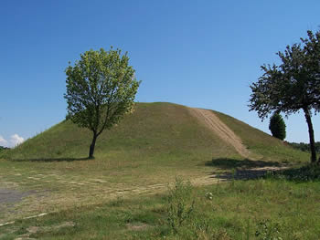
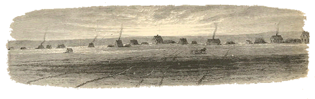
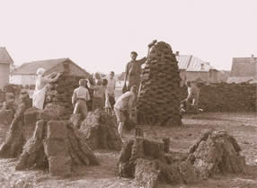
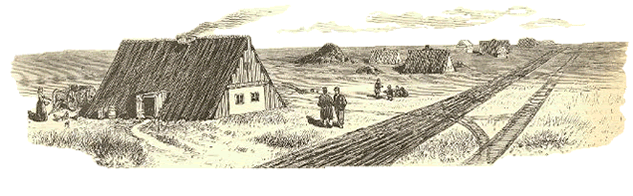
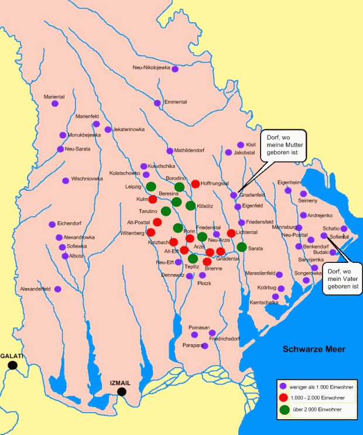
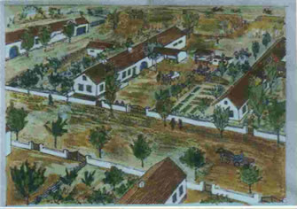

# Sofiental

**(Sofiyivka, Stawrowa, Sofiivka Софиевка/Софіївка)**  
**Eine deutsche Tochterkolonie in Bessarabien**

## (Teil 1 von 4)

> Land der Steppen und Kurgane[^t1-1],  
> stilles Bessarabien!  
> Unter deinen stolzen Fahnen  
> woll'n wir Deutschen feste steh'n.  
> Weite Steppen, grüne Wiesen,  
> reiches, fruchtbeladenes Land,  
> hoch und herrlich sei gepriesen  
> unser zweites Vaterland.

Solo

 <!-- Image description: Photograph of a large grass-covered burial mound with a worn path up its side and a young tree in front, under a clear blue sky. -->  
*Kurgan*

Sofiental gehörte nicht zu den Muttergemeinden, die zu beiden Seiten des Steppenflusses[^t1-2] Kogelnik (Cogâlnic) in den Jahren zwischen 1814 und 1823 gegründet wurden. Die Ländereien links und rechts des Kolonistengebietes hatte der Zar an seine Generale verteilt, die sich durch besondere Verdienste um den Hof rühmen durften. Einer dieser Glücklichen war der Großfürst Demidow, dem Zehntausende von Desjatinen[^t1-3] zugeteilt wurden – mit dem Befehl, sie baldmöglichst zu besiedeln.

Das Dorf Demidowka (Demidovka) war der Beweis des kläglichen Scheiterns dieses Unternehmens. Einen kleinen Teil dieses riesigen Besitzes (2785 Desjatinen südwestlich von Akkerman) vererbte er seiner Tochter Sofia Demidow.

### Die Entstehung der Pächterkolonie Sofiental

Gräfin Sofia, die selbst in [Paris](http://atlas.mapquest.com/maps/map.adp?zoom=5&latlongtype=decimal&latitude=46.055&longitude=29.2889) lebte, siedelte auf diesem Land deutsche Pächter an, die als Gründer des Dorfes Sofiental zu betrachten sind.

*[Embedded map omitted]* <!-- Image description: Embedded Google satellite map of farmland centred on Sofiivka (Софіївка), outlined in red, with nearby villages including Cherkesy, Avydivka, Adamivka, Bilen'ke, Serhiivka and Chabans'ke. -->  
[Größere Kartenansicht](https://maps.google.it/maps?f=q&source=embed&hl=it&q=Sofiivka,+Bilhorod-Dnistrovs%27kyi+district,+Oblast%27+di+Odessa,+Ucrania&aq=&sll=46.050004,30.29995&sspn=0.073389,0.181789&ie=UTF8&geocode=FY-nvgIdJC7OAQ&split=0&hq=&hnear=Sofiivka,+Bilhorod-Dnistrovs%27kyi+district,+Oblast%27+di+Odessa,+Ucrania&t=h&ll=46.04917,30.28965&spn=0.095312,0.212517&z=12&iwloc=A)

Diese Besiedlung erfolgte im Spätsommer 1863. Die Pächter kamen hauptsächlich aus den Gemeinden Großliebental, Alexanderhilf und Neuburg im Regierungsbezirk Cherson am Fluss Dnjepr, jenseits des bessarabischen Grenzflusses Dnister.

 <!-- Image description: Engraving of a line of low houses with smoking chimneys spread across a flat, empty steppe, with a horse-drawn cart in the middle distance. -->

Laut Pachtvertrag mussten jährlich 1 Rubel und 50 Kopeken pro Desjatine bezahlt werden. Die Siedlung sollte den Namen der Herrin (Sofia) bekommen. So kam es zur Namensgebung „Sofiental“.

### Der Bau der 1. Siedlerhäuser in Sofiental

Gräfin Sofia Demidow war eine sehr gütige und hilfsbereite Frau, die die Pächter auch beim Bau ihrer Häuser kräftig unterstützte. So schenkte sie den Siedlern die Steine für das Fundament eines jeden Siedlerhäuschens und später auch noch alle Steine zum Bau des Schul- und Bethauses.

 <!-- Image description: Sepia photograph of men, women and children stacking dark, brick-like blocks into tall conical piles in a yard, with houses behind. -->

Die Wände der Häuser wurden aus Lehm gestampft, oder aus einem Stroh-Lehm-Gemisch hergestellt. Von der Festigkeit dieser Bauweise konnten sich auch die Käufer noch nach mehr als 30 Jahren überzeugen, als die Pächterhäuschen abgerissen werden mussten, um Neubauten Platz zu machen.

Trotz der primitiven Bauweise waren es gesunde und trockene Wohnungen: im Sommer kühl und im Winter warm und gemütlich.

 <!-- Image description: Engraving of a thatched, half-timbered steppe house with a smoking chimney and figures and a cart outside, beside a long straight track running to other houses on the horizon. -->

Warum die Pächter im Laufe der nächsten Jahre nicht käuflich erworben haben, ist nicht bekannt. Auch die Pachtzinserhöhung auf 2 Rubel 50 Kopeken im zweiten Pachtvertrag konnte kein Grund dazu gewesen sein. Das Hauptverhängnis war wohl die Nähe der Kreisstadt Akkerman (15 km) und das sorglose „In den Tag hineinleben“. Die erste große Missernte wurde deshalb den Pächtern auch zum Verhängnis. Sie konnten den fälligen Pachtzins nicht mehr bezahlen.

### Der Verkauf der Gemeinde Sofiental

Der Bruch der eingegangenen Verpflichtungen veranlasste die Gräfin die Verträge im Jahr 1899 zu annullieren und das Land zum Verkauf anzubieten.

Der Bevollmächtigte bot das Land samt Bauten und Gärten usw. dem im bessarabischen Unterland überall bekannten Landkaufvermittler Gottfried Schulz aus [Neu-Posttal](http://atlas.mapquest.com/maps/map.adp?zoom=5&latlongtype=decimal&latitude=46.0333&longitude=30.1167) an.

Damit war das bittere Los der Pächter besiegelt. Der endgültige Beschluss der immer nachsichtigen und gütigen Gräfin schlug wie ein Blitz aus heiterem Himmel bei ihnen ein. Fast alle glaubten, die Schuld nicht bei sich selbst, sondern bei den neuen Käufern und ganz besonders bei dem Kaufvermittler Schulz suchen zu müssen.

Ob die Gräfin die Pächter für die Gebäude und was sie sonst noch zurücklassen mussten, entschädigt hat, ist nicht aktenkundig.

Auf jeden Fall kamen die meisten Pächterfamilien jetzt in ganz große Not. Wohin sollten sie? Auch bei der Versteigerung des beweglichen Inventars, die vor der Übergabe des Dorfes an die neuen Eigner erfolgte, kamen die Pächter sehr schlecht weg.

Zu diesem Zeitpunkt waren noch folgenden Pächterfamilien in Sofiental:

Ahnert Friedrich, Berg Christine, Berg Friedrich, Beck Karl, Berg Jakob, Berg Vinzens, Esch Andreas, Fink Katharina, Hannemann Martin, Hannemann Martin II, Löffler Jakob, Maaß Friedrich, Mutschler Jakob, Näher Jakob, Näher Ludwig, Raußer Gustav, Renz Katharina, Roller Georg, Schmidt Friedrich, Schramm Gottlieb, Schuler Johann, Schüler Charlotte, Steeg August, Steeg August II, Stefan Johann, Stephan Philipp (der Metzger), Stortz Felix (der Schmied), Leonhard Torno, Wiedmaier Peter und Zweigle Christian.

[^t1-1]: **Kurgan** = großer, aus Erde und/oder Steinen aufgeschütteter kegelförmiger Grabhügel, der oft weithin sichtbar ist. Oft bildet er eine Kette von 5 bis 10 Kilometer Länge. Man findet ihn vorwiegend auf der höchsten Erhebung in den Steppengebieten.  
    In der Eisenzeit (1. Jahrtausend v. Chr.) wurden Kurgane vor allem von Skythen und Sarmaten auch im Schwarzmeergebiet errichtet. In den unterirdischen Grabkammern beerdigten die Skythen ihre kostbar geschmückten Fürsten und Heerführer mitsamt deren Frauen und Konkubinen, Leibdienern und geopferten Pferden. Ausgestattet mit ihren besten Waffen, prunkvollen Kleidern, Gerätschaften und mit Wein gefüllten Amphoren sollten die Verstorbenen auch im Jenseits die Annehmlichkeiten ihres Herrscherdaseins genießen können.  
    Für eine Anlage eines Kurgans mit einem Volumen von 75 000 m³ benötigte man immerhin eine 75 000 ha große Grasfläche.

[^t1-2]: **Steppenfluss** = Viele Steppenflüsse erhalten ihr Wasser nicht durch Quellen, sondern durch Regen und Schneeschmelze und trocknen in der Sommerhitze häufig aus.

[^t1-3]: 1 Desjatine = 1,0925 ha

**Quelle:** Berthold Mayer: *Sofiental - Eine deutsche Gemeinde in Bessarabien, Greiserdruck Rastatt, 1973;*

## Teil 2 von 4)

Sofiental wurde im Sommer 1899 zum Kaufpreis von 180 Rubel pro Desjatine über den Kaufvermittler Gottfried Schulz erworben.

 <!-- Image description: Colour map of southern Bessarabia marking the German villages with dots coloured by population, with speech bubbles pointing to Gnadenfeld ("Dorf, wo meine Mutter geboren ist") and Sofiental ("Dorf, wo mein Vater geboren ist"). -->

Der Boden war eine sehr gute, fette, einheitliche Schwarzerdeschicht bis zu 1 Meter dick. Steine und Sand gab es nicht.

Der Kaufbrief wurde pauschal auf drei Käuferbevollmächtigte in Odessa abgeschlossen, dem eine Namensliste der Käufer beigefügt war. Der Restkaufbetrag wurde, abgesehen von der Anzahlung jedes einzelnen Käufers, von der Odessaer Bauernbank zu 4% vorgesehen. Alljährlich nach der Ernte im Herbst wurden die fälligen Beträge eingesammelt und von 2 Bevollmächtigten nach Odessa gebracht und bei der Bauernbank eingezahlt.

### Der 1. Weltkrieg

Nach Ausbruch des 1. Weltkrieges wurden sämtliche Zins- und Tilgungszahlungen bei den Banken ausgesetzt. Nach Kriegsende aber war Bessarabien an Rumänien angeschlossen worden und der Zugang nach [Odessa](http://www.migrationsmuseum.it/deu/3deutsche_in_russland/odessa/5.1_odessa.html) war deshalb abgeschnitten.

mehr ...... [klicke hier](https://www.bessarabia.altervista.org/deu/1_bessarabien/5_20.jahrhundert3.html)

Ein Einführen der fälligen Tilgungs- und Zinsbeträge war unmöglich geworden. So blieb Sofiental der Bank die letzten Raten und Zinsen schuldig. Die Verbindung war abgerissen und die Bank stellte auch keinerlei Forderungen mehr an die Schuldner in Sofiental.

Folgende Käufer erwarben die 2785 Desjatinen in Sofiental:

- Beck Karl (ehemaliger Pächter)
- Biffart Adam (Pawlowka)
- Brost Jakob (Basyrjamka)
- Dietrich Johann (Neu-Elft)
- Drefs Samuel (Marijewka)
- Eckert Konstantin (Sarata)
- Erdmann Christian (Neu-Elft)
- Fleig Christian (Alt-Posttal)
- Friedrich Karl (Basyrjamka)
- Hermann Georg (Teplitz)
- Hermann Johann (Dennewitz)
- Hiller Samuel I. (Neu-Elft) – **mein Urgroßvater väterlicherseits**
- Irion Daniel (Neu-Elft)
- Krüger Andreas (Neu-Elft)
- Mayer Johann (Dennewitz)
- Müller Daniel (Dennewitz)
- Ost Friedrich (Eigenfeld)
- Raab, Gottfried (Neu-Elft)
- Schaupp Jakob (Neu-Elft)
- Schlechter David (Plotzk)
- Schuler Johann (ehemaliger Pächter)
- Seitz Johannes (Dennewitz)
- Siewert Johann (Neu-Elft)
- Springer Adam (Neu-Posttal)
- Voßler Christoph (Hoffnungsfeld)
- Witt Immanuel (Plotzk)

**Quelle:** Berthold Mayer: *Sofiental - Eine deutsche Gemeinde in Bessarabien, Greiserdruck Rastatt, 1973;*

## Teil 3 von 4)

### Die Verteilung der Häuser

Die Wohnungshäuser und Wirtschaftsgebäude, die von den Pächtern zurückgelassen wurden, waren in Größe und Bauzustand sehr verschieden. Deshalb wählte man eine Kommission, die den Wert von Fall zu Fall festzusetzen hatte. Die Vereinbarung lautete, dass der errechnete Gesamtwert durch die Desjatinenzahl geteilt wurde. Wer also bessere Bauten hatte, als ihm zustand, hatte die Differenz an die Ausgleichskasse zu zahlen.

Diese Kasse vergütete die Zulagen für die kleinen Häuschen und Gebäude, die in sehr schlechtem Zustand waren.

Beim Kauf wurden 48 bebaute Hofstellen übernommen, die nach dem Sonnenzirkel angelegt waren. Das Dorf lag in einer flachen Talmulde, die sich von Norden nach Süden zog und nach Süden immer mehr abfiel. Die Straße war 50 Faden[^t3-1] breit.

Das Dorfende war knapp 150 Faden von der Gemarkung Kadajeschti entfernt. Somit besaß Sofiental nur nach 3 Seiten hin Land, was für die Bewirtschaftung nicht sehr günstig war. Die Pächter waren damals aber gezwungen, gerade hier ihr Dorf anzulegen, weil hier die einzige Talsenke auf dem Land der Gräfin Sofia war.

### Die Dorfanlage

 <!-- Image description: Naive painting of a village seen from above: white houses with red-tiled roofs set in fenced farmyards with gardens and trees along a broad street. -->

Die Dörfer legte man damals nur in Tälern an, damit die Brunnen nicht noch tiefer ausgeschachtet werden mussten.

Jede Hofstelle war 20 Faden breit und zählte (zusammen mit der Hälfte der Straßenbreite) eine Desjatine. Zu jeder Hofstelle gehörten 50 Desjatinen Land. Im Jahr 1900 zählte Sofiental 56 Hofstellen.

### Die Entwicklung der Gemeinde Sofiental

Durch gute Ernten und sparsames Wirtschaften entwickelte sich Sofiental schon nach wenigen Jahren zu einer wohlhabenden Gemeinde. Gleich in den ersten Jahren musste sehr viel gebaut werden. Die übernommenen Wirtschaftsgebäude waren für die stark vergrößerte Landwirtschaft der Eigentümer viel zu klein.

Begünstigt wurde der Aufschwung auch durch die Nähe der Kreis- und Hafenstadt Akkerman (15 km). Getreide, Schlachtvieh und alle sonstigen Produkte fanden dort immer guten Absatz.

So war es kein Wunder, dass die eifrigen Sofientaler schon bald an weiteren Landzukauf dachten. Die Gelegenheit bot sich, als Graf Masarowitsch, der Schwiegervater des Generals Demidow, wieder einmal in großer Geldverlegenheit war und deshalb 1.000 Desjatinen von seinem Besitz südlich der Sofientaler Grenze zum Verkauf anbot.

Im Herbst 1906 wurde das Land zu 250 Rubel je Desjatine von Wilhelm Bechtle (mein Urgroßvater mütterlicherseits), der von [Sarata](http://atlas.mapquest.com/maps/map.adp?zoom=5&latlongtype=decimal&latitude=46.0167&longitude=29.6667) nach Sofiental zugewandert war, und noch anderen Sofientalern gekauft. 50 Rubel pro Desjatine mussten sofort beim Abschluss des Kaufvertrags bezahlt werden. Der Rest war in 20 Jahresraten bei 6% Schuldzinsen zu tilgen. Wie schon erwähnt, wurden alle Tilgungs- und Zinszahlungen, laut eines Erlasses des Zaren, nach Kriegsausbruch eingestellt.

Hier die Liste der Käufer der 1.000 Desjatinen:

- Bechtle Wilhelm I. (mein Urgroßvater mütterlicherseits)
- Brost August
- Brost Jakob
- Hiller Samuel I. (mein Urgroßvater väterlicherseits)
- Hiller Samuel II.
- Irion Nathanael
- Müller Daniel I.
- Müller Daniel II.
- Schlechter David
- Schulz August
- Seitz Johannes

Das zugekaufte Grundstück hatte die Form eines Rechtecks und schloss nach Osten wie nach Westen mit den Grenzen der Gemarkung Sofiental ab.

Es hatte auch sehr gute Schwarzerde, denn je näher man zum Meer kam, desto besser und ertragreicher wurde der Boden. So kam es, dass Sofiental vor dem 1. Weltkrieg bereits 4139 Desjatinen Land besaß.

Sofiental war eine blühende Gemeinde geworden. Die Bürger hatten es durch Fleiß und Sparsamkeit zu großem Wohlstand gebracht und waren bei Behörden und in der Finanzwelt dementsprechend gut gesehen. Das sollte sich aber bald ändern.

[^t3-1]: 1 Faden = 2,1336 m

**Quelle:** Berthold Mayer: Sofiental - Eine deutsche Gemeinde in Bessarabien, Greiserdruck Rastatt, 1973;

## Teil 4 von 4)

### Sofiental im 1. Weltkrieg

Die Kriegsjahre (nach dem 1. August 1914) waren für die Bessarabiendeutschen nicht leicht. Über Nacht wurden sie von den Behörden zu „politisch Unzuverlässigen“ gestempelt. Das brachte den Deutschen im Zarenreich überall zu Unannehmlichkeiten.

### Die Diskriminierung der Deutschen in Bessarabien

Da Sofiental an der äußersten Südostspitze der deutschen Siedlungen in Bessarabien lag, hatten seine Bewohner unter dieser Hetze besonders zu leiden. Viel schlimmer wurde es aber, als nach der Oktoberrevolution plündernde Anhänger Lenins durch das Land zogen. Auch der ärmste Sofientaler war in ihren Augen noch ein fetter Kulake[^t4-1] (Großkapitalist im Bereich der Landwirtschaft), den es auszumerzen galt. Kein Wunder, dass in jenen Wochen bei jedem Sofientaler nicht nur ein geladenes Jagdgewehr an der Wand hing, sondern auch ein Karabiner griffbereit unter der Bettdecke lag.

Nach dem Einmarsch der rumänischen Truppen und der Angliederung Bessarabiens an das Königreich Rumänien war die kommunistische Gefahr zwar gebannt, dafür drohten aber neue Gefahren.

mehr ...... [klicke hier](https://www.bessarabia.altervista.org/deu/1_bessarabien/5_20.jahrhundert3.html)

### Das rumänische Agrarreformgesetz

Das Agrarreformgesetz, das im Altreich Grundbesitz über 500 ha enteignete und an Landlose aufteilte, setzte die Besitzgröße für Bessarabien auf 100 ha herab. Natürlich trafen diese Härten hier in erster Linie die Deutschen. Auch der Kauf von Ackerland wurde weitgehend unterbunden.

Die bisherigen Wirtschaftskontakte zu Russland waren unterbrochen und mussten durch andere ersetzt werden.

Der Gesetzgeber hatte es darauf abgesehen, landlose Kriegsteilnehmer aus Rumänien in die neu angelegten Gebiete (Banat, Siebenbürgen[^t4-2], Buchenland, [Bessarabien](https://www.bessarabia.altervista.org/deu/1_bessarabien/1.1_geografie.html)) zu verpflanzen.

Auf diese Weise entstanden von 1919-1929 14 sogenannte [Hektargemeinden](https://www.bessarabia.altervista.org/deu/6dt_kolonien/1.3_hektargemeinden.html).

Trotzdem müssen die Bessarbiendeutschen den Rumänen dankbar sein, dass sie sie durch die Besetzung Bessarabiens vor dem [Schicksal der Russlanddeutschen](http://www.migrazioni.altervista.org/deu/3deutsche_in_russland/05_18jahrhundert/4.11_wolgadeutsche.html#deportation) bewahrt haben.

Bis zum Einmarsch der Roten Armee im Jahr 1940 hatten die Sofientaler wieder einen Großteil des enteigneten Landes zurückgekauft.

Nach dem 1. Weltkrieg, als die Gefahr der Deportation nach Sibirien vorüber war, dachte man an die Verschönerung der Gemeinde. Im alten Dorfteil wurden die Gehwege verbreitert und auf jeder Seite zwei Reihen Akazienbäume angepflanzt. Dazwischen fanden Flieder, Rosen und Staudengewächse ihren Platz. Im Jahr 1937 wurde die Beleuchtung der Straße beschlossen und Petromaxlampen montiert. Jahraus und jahrein hatte man nun gut beleuchtete Straßen.

[^t4-1]: **Kulak** = Begriff, der im Russischen seit dem 19. Jahrhundert für relativ wohlhabende Bauern verwendet wurde. Bis 1917 war er auch eine abwertende Bezeichnung für Vermittler, Wucherer und Betrüger. Nach der Oktoberrevolution von 1917 wurde die Bedeutung des Begriffes "Kulak" mit allen "Landausbeutern" gleichgesetzt: Selbst diejenigen, die nur eine Kuh hatten oder einen Tageslöhner oder Diener beschäftigten gehörten zu dieser Kategorie. Diese Menschen und ihre Familie wurden als Klassenfeinde diffamiert und verfolgt.

[^t4-2]: **Siebenbürgen** = Landschaft, im Innern des Karpatenbogens, die heute zu Rumänien gehört. Vom 3. Jahrhundert v. Chr. an Teil des Königreichs der Daker, 106-271 n. Chr. Teil der römischen Provinz Dakien, seit dem 7. Jahrhundert von Bulgaren, seit dem 9./10. Jahrhundert von Ungarn beherrscht, vom 11. bis 13. Jahrhundert der ungarischen Krone unterstellt.  
    Zum Grenzschutz wurden im 10. Jahrhundert Szekler, ab etwa 1150 deutsche Bauern und Handwerker (Siebenbürger Sachsen) angesiedelt; 1211-25 breitete sich im Burzenland (historische Grenzlandschaft im Südosten Siebenbürgens) der Deutsche Orden aus. Eine rumänische Bevölkerung ist erst seit etwa 1210 sicher bezeugt. 1437 »Union der drei Nationen« (Ungarn, Szekler, Sachsen) zur Abwehr der seit 1432 vordringenden Türken.  
    Die Bedrohung durch die Türken führte nach 1493 bis etwa 1530 zum Um- und Ausbau der Kirchen zu Kirchenburgen. Nach der Schlacht bei Mohács (1526) kam Siebenbürgen unter osmanische Oberhoheit; 1688 bzw. 1691 fiel Siebenbürgen vorläufig, 1699 (Frieden von Karlowitz) bei Wahrung seiner Autonomie endgültig an die Habsburger (Österreich); 1848/49 kurz, nach dem österreichisch-ungarischen Ausgleich 1867 wieder mit Ungarn vereinigt. Die Magyarisierungspolitik stieß auf den entschiedenen Widerstand der dort lebenden Rumänen und Sachsen. Durch den Frieden von Trianon (1920) kam Siebenbürgen an Rumänien, durch den 2. Wiener Schiedsspruch (1940) Nordsiebenbürgen und das Szeklerland (Ostsiebenbürgen) an Ungarn, durch den Pariser Frieden (1947) ganz Siebenbürgen wieder an Rumänien.

**Quelle:** Berthold Mayer: *Sofiental - Eine deutsche Gemeinde in Bessarabien, Greiserdruck Rastatt, 1973;*
